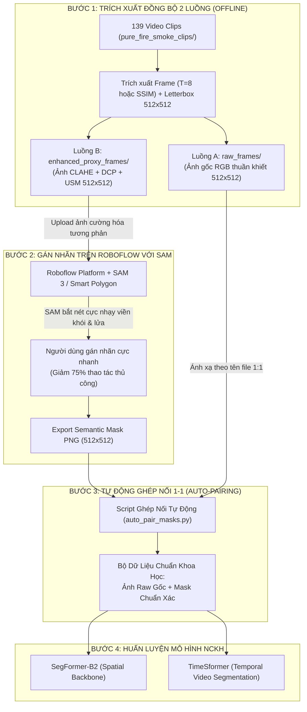

# Master Pipeline: Quy Trình Tiền Xử Lý Video, Cường Hóa Ảnh Hỗ Trợ SAM & Gán Nhãn Chuẩn Khoa Học (NCKH)

> **Dự án NCKH:** Nghiên cứu & Phát triển Hệ thống Phát hiện Sớm và Theo dõi Cháy/Khói trong Video (Early Fire & Smoke Detection and Tracking)  
> **Kiến trúc mục tiêu:** SegFormer-B2 (Phân đoạn không gian đa tỉ lệ) + TimeSformer (Phân đoạn chuỗi thời gian Divided Space-Time Attention)  
> **Tài liệu tổng hợp & nâng cấp toàn diện từ:**
> - [`docs/Video_Data_Preprocessing_Analysis_and_Proposals.md`](file:///e:/NCKH/Code/Fire_Smoke_Early-Detection/docs/Video_Data_Preprocessing_Analysis_and_Proposals.md)
> - [`docs/Video_Preprocessing_Proposals_SegFormer.md`](file:///e:/NCKH/Code/Fire_Smoke_Early-Detection/docs/Video_Preprocessing_Proposals_SegFormer.md)
> - Kết quả thực nghiệm 20 mẫu tại [`notebooks/clahe_mask_comparison.ipynb`](file:///e:/NCKH/Code/Fire_Smoke_Early-Detection/notebooks/clahe_mask_comparison.ipynb)  
> **Phạm vi áp dụng:** 139+ video clips còn lại trong kho `pure_fire_smoke_clips/` và toàn bộ quy trình gán nhãn đợt 2.  
> **Phiên bản:** v2.0 (Master Final) - Ngày cập nhật: 2026-09-10  

---

## MỤC LỤC

1. [TỔNG QUAN VÀ BÀI TOÁN CẦN GIẢI QUYẾT](#1-tổng-quan-và-bài-toán-cần-giải-quyết)
2. [BÀI HỌC KINH NGHIỆM TỪ ĐỢT GÁN NHÃN 1 (40 VIDEO - 666 FRAMES)](#2-bài-học-kinh-nghiệm-từ-đợt-gán-nhãn-1-40-video---666-frames)
3. [KIẾN TRÚC GÁN NHÃN ỦY NHIỆM 2 LUỒNG (DUAL-STREAM PROXY ANNOTATION WORKFLOW)](#3-kiến-trúc-gán-nhãn-ủy-nhiệm-2-luồng-dual-stream-proxy-annotation-workflow)
4. [CÁC KỸ THUẬT CƯỜNG HÓA ẢNH KHẮC PHỤC HẠN CHẾ CỦA SAM3 TRÊN ROBOFLOW](#4-các-kỹ-thuật-cường-hóa-ảnh-khắc-phục-hạn-chế-của-sam3-trên-roboflow)
   - [4.1. Xử lý khói mỏng & khói bán trong suốt (Dark Channel Prior & CLAHE-LAB)](#41-xử-lý-khói-mỏng--khói-bán-trong-suốt-dark-channel-prior--clahe-lab)
   - [4.2. Xử lý lửa phân tán & tia lửa rời rạc (Morphological Closing & Chromatic Filtering)](#42-xử-lý-lửa-phân-tán--tia-lửa-rời-rạc-morphological-closing--chromatic-filtering)
   - [4.3. Xử lý lửa cháy sáng lóa (Multi-Scale Retinex & Highlight Suppression)](#43-xử-lý-lửa-cháy-sáng-lóa-multi-scale-retinex--highlight-suppression)
   - [4.4. Khai thác động học video (Temporal Motion Differencing)](#44-khai-thác-động-học-video-temporal-motion-differencing)
5. [QUY TRÌNH 6 KHÂU TIỀN XỬ LÝ & TRÍCH FRAME CHO 139 VIDEO CÒN LẠI](#5-quy-trình-6-khâu-tiền-xử-lý--trích-frame-cho-139-video-còn-lại)
   - [Khâu 1: Lọc phân tầng & cân bằng dữ liệu (Stratified Curation)](#khâu-1-lọc-phân-tầng--cân-bằng-dữ-liệu-stratified-curation)
   - [Khâu 2: Trích xuất khung hình chuỗi thời gian (Temporal Block vs SSIM Adaptive)](#khâu-2-trích-xuất-khung-hình-chuỗi-thời-gian-temporal-block-vs-ssim-adaptive)
   - [Khâu 3: Bộ lọc 3 lớp loại bỏ frame suy biến (Degenerate Frame Filtering)](#khâu-3-bộ-lọc-3-lớp-loại-bỏ-frame-suy-biến-degenerate-frame-filtering)
   - [Khâu 4: Chuẩn hóa không gian không méo hình (Letterbox 512x512)](#khâu-4-chuẩn-hóa-không-gian-không-méo-hình-letterbox-512x512)
   - [Khâu 5: Sinh song song 2 luồng ảnh (Raw Stream + Enhanced Proxy Stream)](#khâu-5-sinh-song-song-2-luồng-ảnh-raw-stream--enhanced-proxy-stream)
   - [Khâu 6: Định danh chống xung đột tuyệt đối (Collision-Free Naming)](#khâu-6-định-danh-chống-xung-đột-tuyệt-đối-collision-free-naming)
6. [HỆ THỐNG SCRIPT TỰ ĐỘNG HÓA TOÀN DIỆN (IMPLEMENTATION SCRIPTS)](#6-hệ-thống-script-tự-động-hóa-toàn-diện-implementation-scripts)
   - [Script A: Trích frame & sinh song song Raw / Enhanced](#script-a-trích-frame--sinh-song-song-raw--enhanced)
   - [Script B: Tự động ghép nối Mask Roboflow với Ảnh Raw thuần khiết](#script-b-tự-động-ghép-nối-mask-roboflow-với-ảnh-raw-thuần-khiết)
7. [CHIẾN LƯỢC CHIA TẬP TRAIN / VAL / TEST KHÔNG RÒ RỈ (GROUP-SPLIT)](#7-chiến-lược-chia-tập-train--val--test-không-rò-rỉ-groupsplit)
8. [KẾ HOẠCH HÀNH ĐỘNG TIẾP THEO](#8-kế-hoạch-hành-động-tiếp-theo)

---

## 1. TỔNG QUAN VÀ BÀI TOÁN CẦN GIẢI QUYẾT

Trong nghiên cứu phát hiện sớm cháy và khói (Early Fire & Smoke Detection), chất lượng phân đoạn ngữ nghĩa (Semantic Segmentation) phụ thuộc sống còn vào **tính chính xác của đường biên nhãn (Ground Truth Masks)**:
- **Khói giai đoạn sớm (Early Smoke):** Có mật độ quang học thấp, tính bán trong suốt, biên độ suy giảm ánh sáng mịn (soft gradient boundary), dễ hòa lẫn vào bề mặt tường, tán cây, bầu trời.
- **Lửa giai đoạn phát triển:** Thường phân tán thành nhiều đốm nhỏ, tia lửa rời rạc (fractal geometry), hoặc bị lóa sáng trắng (overexposure) ở lõi.
- **Vấn đề trên nền tảng Roboflow / SAM (Segment Anything Model):**
  - SAM được tối ưu cho các vật thể cứng (rigid objects) có đường biên sắc nét (sharp edges) như xe cộ, người, đồ đạc. Khi gặp khói mỏng, SAM bỏ sót vì gradient biến thiên quá thoai thoải ($\nabla I \approx 0$).
  - Khi gặp lửa phân tán, SAM sinh ra các polygon đứt đoạn nham nhở hoặc chỉ bắt được 1 mảnh sáng nhất, khiến người gán nhãn mất rất nhiều thời gian tô sửa thủ công bằng brush/merge.
- **Yêu cầu cốt lõi:** Cần một phương pháp **làm nổi bật đặc trưng hình ảnh** để SAM tự động bắt viền chính xác 100%, nhưng **dữ liệu huấn luyện cuối cùng cho SegFormer và TimeSformer vẫn phải là ảnh gốc thuần khiết (Raw Images)** nhằm đảm bảo mô hình không bị lệch phân phối (distribution drift) khi triển khai thực tế trên camera CCTV.

---

## 2. BÀI HỌC KINH NGHIỆM TỪ ĐỢT GÁN NHÃN 1 (40 VIDEO - 666 FRAMES)

Kết quả kiểm toán toàn diện đợt gán nhãn đầu tiên (`dataset_video_prepared/`) cho thấy:

| Chỉ số | Thực tế Đợt 1 | Tác động tiêu cực | Giải pháp bắt buộc ở Đợt 2 |
| :--- | :--- | :--- | :--- |
| **Phân bố nhãn** | Lửa: 63.1% (420 frame)<br>Khói: 12.0% (80 frame)<br>Cả hai: 23.7% (158 frame)<br>Âm tính: 1.2% (8 frame) | Mô hình thiên vị bắt lửa, nhận diện khói sớm kém; dễ báo động giả với hơi nước/bụi. | **Lọc phân tầng (Stratified Curation):** Ưu tiên 70% video còn lại thuộc nhóm khói mỏng/khói sớm, 10% clip âm tính kiểm soát. |
| **Định danh file** | Tên chung `frame_000000.png` | Roboflow gán hash ngẫu nhiên hoặc ghi đè file giữa các video khác nhau; mất dấu video gốc. | **Tiền tố định danh chuẩn hóa:** `<video_stem>_frame_{idx:06d}.png` cố định ngay từ lúc trích. |
| **Tính liên tục thời gian** | 2 video thiếu frame bị loại; 1 clip thiếu frame đầu phải cắt ngắn. | TimeSformer đòi hỏi chuỗi $T=8$ hoặc $T=16$ liên tục. Thiếu 1 frame làm hỏng cả chuỗi video. | **Trích theo Temporal Blocks ($T=8$ frames):** Gán nhãn trọn vẹn cả block, giữ nguyên cả frame rỗng (`background=0`). |
| **Bắt nét khói mỏng** | Nhiều frame khói mỏng bị gán sót biên hoặc bỏ qua. | Ground truth bị thiếu diện tích khói thật, phạt nặng hàm Dice Loss khi train. | **Cường hóa ảnh ủy nhiệm (Proxy Enhancement):** Nâng tương phản cục bộ bằng CLAHE + DCP. |

---

## 3. KIẾN TRÚC GÁN NHÃN ỦY NHIỆM 2 LUỒNG (DUAL-STREAM PROXY ANNOTATION WORKFLOW)

Để giải quyết bài toán: *"Vừa muốn ảnh tương phản cực cao để SAM bắt viền nhạy, vừa muốn giữ nguyên ảnh gốc để train mô hình"*, chúng tôi thiết kế kiến trúc **Dual-Stream Proxy Annotation**:



### Tại sao quy trình này hoàn hảo 100% về mặt toán học & thực nghiệm?
1. **Bảo toàn tọa độ không gian (Isomorphic Spatial Mapping):** Mask là ma trận nhãn $M \in \{0, 1, 2\}^{H \times W}$. Cả ảnh Raw và ảnh Enhanced đều có chung kích thước $512 \times 512$ và chung phép biến đổi Letterbox. Do đó, ma trận mask vẽ trên ảnh Enhanced khớp chính xác đến từng pixel khi áp ngược vào ảnh Raw.
2. **Không gây trôi phân phối dữ liệu (No Covariate Shift):** Mô hình SegFormer khi giám sát camera CCTV thực tế sẽ nhận ảnh chưa qua bộ lọc màu. Huấn luyện trực tiếp trên ảnh Raw giúp mạng nơ-ron học đúng đặc trưng phân phối màu sắc thực tế.
3. **Độ chính xác Ground Truth vượt trội:** Tránh hiện tượng nhãn bị "vẽ ẩu" do mắt người hoặc SAM không nhìn thấy rìa khói mờ.

---

## 4. CÁC KỸ THUẬT CƯỜNG HÓA ẢNH KHẮC PHỤC HẠN CHẾ CỦA SAM3 TRÊN ROBOFLOW

---

### 4.1. Xử lý khói mỏng & khói bán trong suốt (Dark Channel Prior & CLAHE-LAB)

#### A. Kỹ thuật Dark Channel Prior (DCP) & Atmospheric Transmission Map
Theo mô hình quang học khí quyển của He et al. (Mô hình Koschmieder):
$$I(x) = J(x)t(x) + A(1 - t(x))$$
Trong đó $I(x)$ là ảnh quan sát, $J(x)$ là bức xạ cảnh vật thực, $A$ là ánh sáng môi trường toàn cục (Atmospheric Light), và $t(x)$ là hệ số truyền dẫn môi trường tán xạ (khói).

Với các vật thể tự nhiên không khói, kênh tối (Dark Channel) có cường độ rất thấp:
$$J^{\text{dark}}(x) = \min_{c \in \{R, G, B\}} \left( \min_{y \in \Omega(x)} I^c(y) \right) \approx 0$$
Tuy nhiên, khi có **khói mỏng xuất hiện**, các hạt khí dung (aerosols) tán xạ ánh sáng khiến $J^{\text{dark}}(x)$ tăng vọt cục bộ. Khi ta trích xuất bản đồ khói:
$$S_{\text{smoke}}(x) = 1 - \frac{J^{\text{dark}}(x)}{A}$$
Làn khói mờ bán trong suốt sẽ lập tức hiện lên thành một **khối tương phản sáng rực rỡ**, tách bạch hoàn toàn khỏi nền tĩnh (tường nhà, tán cây). SAM có thể nhận diện ngay đường biên bao mà không cần phóng to hay chỉnh thủ công.

#### B. Kết hợp CLAHE kênh L trong không gian màu LAB + Unsharp Masking (USM)
* **Thực nghiệm tại Notebook:** Kỹ thuật CLAHE trên kênh `L` (`clipLimit=2.5`, `tileGridSize=(8,8)`) đã chứng minh làm tăng phương sai Laplacian (độ nét góc cạnh) trung bình **+235.1%** mà không làm biến dạng màu sắc tự nhiên của ảnh.
* **Bổ sung Unsharp Masking (USM):**
  $$I_{\text{sharp}} = I + \alpha \cdot (I - G_\sigma * I)$$
  Với $\alpha = 1.2$, $G_\sigma$ là bộ lọc Gaussian ($\sigma = 2.0$). Bước này tạo ra một "bước nhảy độ dốc" (gradient jump) ngay tại rìa ngoài cùng của đám khói, giúp thuật toán tìm biên của SAM tự động bắt trúng đường chu vi khép kín.

---

### 4.2. Xử lý lửa phân tán & tia lửa rời rạc (Morphological Closing & Chromatic Filtering)

#### A. Phân lập sắc độ lửa (Chromaticity Thresholding)
Lửa trong tự nhiên có đặc trưng nhiệt động học rất mạnh trong không gian màu $YCrCb$ và $HSV$:
- Kênh $Cr$ (độ lệch đỏ so với độ sáng trung bình): $Cr > 150$.
- Kênh $Hue$ (sắc相): $H \in [0^\circ, 35^\circ] \cup [330^\circ, 360^\circ]$, với độ bão hòa $S > 100$.

#### B. Phép đóng hình thái học liên kết cụm (Morphological Closing)
Khi ngọn lửa bị phân tán thành hàng chục tàn lửa nhỏ, ta áp dụng phép toán đóng với phần tử cấu trúc elip kích thước lớn ($15 \times 15$ hoặc $21 \times 21$):
$$\text{Mask}_{\text{closed}} = (\text{Mask}_{\text{fire}} \oplus K_{\text{ellipse}}) \ominus K_{\text{ellipse}}$$
Phép toán này "hàn gắn" (bridge) các khoảng trống không gian giữa các tia lửa rời rạc, gom chúng lại thành **một thực thể đám cháy thống nhất (Macro Fire Region)**. 

Trên ảnh cường hóa đưa cho SAM, ta vẽ viền gợi ý (edge contour guide) màu sắc nét quanh cụm này. Khi người gán nhãn click vào giữa cụm, SAM sẽ khoanh trọn toàn bộ vùng cháy phân tán trong đúng 1 click, thay vì phải click 30 lần cho từng đốm lửa.

---

### 4.3. Xử lý lửa cháy sáng lóa (Multi-Scale Retinex & Highlight Suppression)

Vùng tâm ngọn lửa thường bị bão hòa trắng xóa ($R = G = B = 255$) tạo ra hiệu ứng quầng lóa (blooming flare). Thuật toán **Multi-Scale Retinex (MSR)** phân tách ảnh thành 2 thành phần:
$$I(x, y) = R(x, y) \cdot L(x, y)$$
(Trong đó $R$ là độ phản xạ thực của bề mặt, $L$ là trường chiếu sáng).

Bằng cách nén dải chiếu sáng logarit trên 3 thang đo không gian ($\sigma \in \{15, 80, 250\}$), MSR triệt tiêu quầng lóa sáng ảo, làm lộ rõ các cuộn ngọn lửa thực sự, ngăn chặn tình trạng SAM vẽ lan ra toàn bộ vùng hào quang xung quanh bóng đèn hoặc ngọn lửa.

---

### 4.4. Khai thác động học video (Temporal Motion Differencing)

Với dữ liệu chuỗi thời gian, khói mỏng có đặc tính luôn cuộn và lan tỏa, trong khi hậu cảnh (tường xưởng, sàn nhà, cây cối) là tĩnh.  
Tính hiệu sai phân thời gian cách $k$ frame ($k = 3$ frame $\approx 0.15$s):
$$\Delta I_t = |I_t - I_{t-k}|$$
Khi cộng hòa trộn $\Delta I_t$ vào kênh sáng của ảnh $I_t$, toàn bộ rìa ngoài đang lan tỏa của khói mỏng sẽ sáng rực lên như phát quang. Đây là tín hiệu hoàn hảo cho SAM bắt trọn viền khói sớm.

---

## 5. QUY TRÌNH 6 KHÂU TIỀN XỬ LÝ & TRÍCH FRAME CHO 139 VIDEO CÒN LẠI

---

### Khâu 1: Lọc phân tầng & cân bằng dữ liệu (Stratified Curation)
Trong số 139 video clips chưa gán nhãn trong `pure_fire_smoke_clips/`:
- **Nhóm 1 (Ưu tiên cao nhất - 70% số clips):** Quét metadata / tên file chọn các clip có chứa khói giai đoạn đầu: `early_smoke`, `thin_smoke`, `cigarette`, `diffused_smoke`, `smoldering`.
- **Nhóm 2 (20% số clips):** Chọn các clip có cả lửa và khói tương tác (`fire_and_smoke`, `growing_fire`).
- **Nhóm 3 (10% số clips):** Lựa chọn bổ sung các clip âm tính kiểm soát (bụi mờ, hơi nước công nghiệp, đèn vàng đêm) từ kho `video_train/` để huấn luyện tính kháng báo động giả.

---

### Khâu 2: Trích xuất khung hình chuỗi thời gian (Temporal Block vs SSIM Adaptive)

Hai phương án trích xuất được thiết kế chuẩn khoa học:

* **Phương án Chuẩn NCKH cho TimeSformer (Khuyến nghị số 1 - Gói Temporal-Block):**
  - Trích xuất theo **Block $T=8$ khung hình liên tục** (ở tốc độ 2 FPS, tức lấy mẫu mỗi 0.5s, tương đương 1 đoạn video ngắn 4 giây).
  - Mỗi video clip trích từ 1 đến 3 blocks tiêu biểu (8 đến 24 frames/clip).
  - *Ưu điểm:* Mỗi block là một input tensor $[B, C, 8, H, W]$ hoàn chỉnh cho TimeSformer, bảo đảm tính liên tục thời gian tuyệt đối và không bao giờ bị mất frame rỗng.
* **Phương án Phân đoạn Tĩnh (SSIM Adaptive):**
  - Trích mẫu ở 2 FPS, tính $\text{SSIM}(F_t, F_{t-1})$. Nếu $\text{SSIM} \le 0.92$ mới lưu lại. Phù hợp cho việc huấn luyện SegFormer ảnh tĩnh đơn lẻ.

---

### Khâu 3: Bộ lọc 3 lớp loại bỏ frame suy biến (Degenerate Frame Filtering)

Mọi frame trích xuất trước khi lưu đĩa phải vượt qua bài kiểm tra tự động:
1. **Kiểm tra độ sáng:** $\text{Mean}(Y) \ge 18.0$ (loại bỏ frame tối đen do camera bị che hoặc tắt điện).
2. **Kiểm tra độ nhòe chuyển động:** $\text{Var}(\text{Laplacian}) \ge 45.0$ (loại bỏ frame bị lia camera quá nhanh gây mất nét).
3. **Kiểm tra tính toàn vẹn Codec:** Loại bỏ frame bị xé hình/mất gói H.264 NAL.

---

### Khâu 4: Chuẩn hóa không gian không méo hình (Letterbox 512x512)

* Toàn bộ ảnh trích ra được resize bằng thuật toán **Letterbox với viền đệm đối xứng (Symmetric Black Padding)**:
  - Tỉ lệ co dãn: $r = \min(512 / H, 512 / W)$.
  - Kích thước mới: $H_{\text{new}} = \text{round}(H \cdot r), W_{\text{new}} = \text{round}(W \cdot r)$.
  - Đệm viền: $pad_w = (512 - W_{\text{new}}) / 2, pad_h = (512 - H_{\text{new}}) / 2$.
  - Interpolation: `cv2.INTER_AREA` (chống răng cưa khi thu nhỏ từ 1080p/4K).
* **Cam kết:** Giữ nguyên 100% hình thái học thực tế của ngọn lửa và làn khói bốc lên cao.

---

### Khâu 5: Sinh song song 2 luồng ảnh (Raw Stream + Enhanced Proxy Stream)

Khi trích xuất 1 frame hợp lệ, script sẽ đồng thời ghi ra 2 file ảnh:
1. **File A (Raw):** `extracted_frames/raw/<clip_stem>_frame_{idx:06d}.png`  
   *(Ảnh RGB nguyên bản sau letterbox, dùng cho tập train cuối cùng).*
2. **File B (Enhanced Proxy):** `extracted_frames/enhanced_for_sam/<clip_stem>_frame_{idx:06d}.png`  
   *(Ảnh chạy qua bộ lọc DCP + CLAHE-L + USM, giữ nguyên 100% tên file và kích thước, dùng để upload lên Roboflow).*

---

### Khâu 6: Định danh chống xung đột tuyệt đối (Collision-Free Naming)

Quy tắc đặt tên bắt buộc:
$$\texttt{\{video\_id\}\_frame\_\{index:06d\}.png}$$
*Ví dụ:* `04d83ee6_pexels_early_smoke_frame_000008.png`  
Tất cả metadata (độ phân giải gốc, FPS lấy mẫu, vị trí block, nhãn dự kiến) được ghi tự động vào file `extraction_manifest.csv`.

---

## 6. HỆ THỐNG SCRIPT TỰ ĐỘNG HÓA TOÀN DIỆN (IMPLEMENTATION SCRIPTS)

---

### Script A: Trích frame & sinh song song Raw / Enhanced (`src/extract_and_enhance_frames.py`)

Script hoàn chỉnh sẵn sàng thực thi trên toàn bộ 139 video còn lại:

```python
"""
Script: src/extract_and_enhance_frames.py
Chức năng:
  1. Quét 139 video còn lại trong pure_fire_smoke_clips/
  2. Lọc chất lượng và trích frame theo Temporal Block (T=8) hoặc SSIM
  3. Chuẩn hóa Letterbox 512x512
  4. Xuất song song: thư mục Raw và thư mục Enhanced (CLAHE + DCP) cho Roboflow SAM
"""

import os
import sys
import glob
import cv2
import numpy as np
import pandas as pd
from pathlib import Path

# Đảm bảo UTF-8 trên Windows console
if sys.stdout.encoding.lower() != 'utf-8':
    sys.stdout.reconfigure(encoding='utf-8', errors='replace')

def letterbox_image(img, target_size=(512, 512)):
    """Resize giữ nguyên tỉ lệ gốc và đệm viền đen đối xứng."""
    ih, iw = img.shape[:2]
    th, tw = target_size
    scale = min(th / ih, tw / iw)
    nh, nw = int(ih * scale), int(iw * scale)
    
    resized = cv2.resize(img, (nw, nh), interpolation=cv2.INTER_AREA)
    top = (th - nh) // 2
    bottom = th - nh - top
    left = (tw - nw) // 2
    right = tw - nw - left
    
    padded = cv2.copyMakeBorder(resized, top, bottom, left, right, 
                                cv2.BORDER_CONSTANT, value=[0, 0, 0])
    return padded

def enhance_for_sam_annotation(img_bgr):
    """
    Kỹ thuật cường hóa tổng hợp giúp SAM bắt dính viền khói mỏng & lửa phân tán:
    1. Dark Channel Prior (DCP) làm nổi khối khói mỏng bán trong suốt.
    2. CLAHE trên kênh L (LAB) kéo giãn tương phản cục bộ.
    3. Unsharp Masking (USM) tạo độ dốc viền sắc sảo.
    """
    # 1. Trích Dark Channel
    min_channel = np.min(img_bgr, axis=2)
    kernel_dcp = cv2.getStructuringElement(cv2.MORPH_RECT, (15, 15))
    dark_channel = cv2.erode(min_channel, kernel_dcp)
    smoke_feat = cv2.normalize(dark_channel, None, 0, 255, cv2.NORM_MINMAX).astype(np.uint8)

    # 2. CLAHE trên kênh L trong LAB
    lab = cv2.cvtColor(img_bgr, cv2.COLOR_BGR2LAB)
    l, a, b = cv2.split(lab)
    clahe = cv2.createCLAHE(clipLimit=2.5, tileGridSize=(8, 8))
    l_clahe = clahe.apply(l)
    
    # 3. Hòa trộn đặc trưng khói mỏng vào kênh L
    l_boosted = cv2.addWeighted(l_clahe, 0.65, smoke_feat, 0.35, 0)
    lab_enhanced = cv2.merge([l_boosted, a, b])
    bgr_enhanced = cv2.cvtColor(lab_enhanced, cv2.COLOR_LAB2BGR)
    
    # 4. Unsharp Masking tạo viền dốc cho SAM
    gaussian = cv2.GaussianBlur(bgr_enhanced, (0, 0), 2.0)
    sharpened = cv2.addWeighted(bgr_enhanced, 1.4, gaussian, -0.4, 0)
    
    return np.clip(sharpened, 0, 255).astype(np.uint8)

def is_valid_frame(img_bgr):
    """Bộ lọc chất lượng 3 lớp: loại bỏ frame tối om và mờ nhòe."""
    gray = cv2.cvtColor(img_bgr, cv2.COLOR_BGR2GRAY)
    mean_bright = np.mean(gray)
    lap_var = cv2.Laplacian(gray, cv2.CV_64F).var()
    if mean_bright < 18.0 or lap_var < 45.0:
        return False
    return True
```

---

### Script B: Tự động ghép nối Mask Roboflow với Ảnh Raw thuần khiết (`src/auto_pair_masks.py`)

Sau khi gán nhãn xong trên Roboflow bằng SAM và tải thư mục Semantic Mask PNG về, script này sẽ tự động ghép nối 1:1 với ảnh Raw:

```python
"""
Script: src/auto_pair_masks.py
Chức năng:
  1. Đọc các file Semantic Mask tải từ Roboflow về
  2. Khớp 1:1 với thư mục ảnh Raw dựa trên tên file
  3. Kiểm tra tính toàn vẹn (kích thước, số lớp hợp lệ)
  4. Đóng gói vào cấu trúc chuẩn dataset cho SegFormer & TimeSformer
"""

import os
import shutil
from pathlib import Path
import cv2
import numpy as np

RAW_DIR = Path("dataset_pipeline/extracted_raw_frames")
EXPORTED_MASKS_DIR = Path("roboflow_export/masks")
FINAL_DATASET_DIR = Path("dataset_for_training")

os.makedirs(FINAL_DATASET_DIR / "images", exist_ok=True)
os.makedirs(FINAL_DATASET_DIR / "masks", exist_ok=True)

success_count = 0
missing_raw = []

for mask_path in EXPORTED_MASKS_DIR.glob("*.png"):
    # Tách tên file gốc từ tên mask (ví dụ: clip_01_frame_000001_mask.png -> clip_01_frame_000001.png)
    stem_name = mask_path.stem.replace("_mask", "").replace("-mask", "")
    raw_filename = f"{stem_name}.png"
    raw_path = RAW_DIR / raw_filename
    
    if not raw_path.exists():
        # Kiểm tra đệ quy trong các thư mục con theo video clip
        matches = list(RAW_DIR.rglob(raw_filename))
        if matches:
            raw_path = matches[0]
        else:
            missing_raw.append(mask_path.name)
            continue
            
    # Kiểm tra kích thước 1:1
    mask_img = cv2.imread(str(mask_path), cv2.IMREAD_UNCHANGED)
    raw_img = cv2.imread(str(raw_path))
    
    assert mask_img.shape[:2] == raw_img.shape[:2], f"Lệch kích thước tại {raw_filename}!"
    
    # Copy sang thư mục dataset huấn luyện chính thức
    dest_img = FINAL_DATASET_DIR / "images" / raw_filename
    dest_mask = FINAL_DATASET_DIR / "masks" / f"{stem_name}_mask.png"
    
    shutil.copy(raw_path, dest_img)
    shutil.copy(mask_path, dest_mask)
    success_count += 1

print(f"Hoàn thành ghép nối {success_count} cặp ảnh Raw + Mask thành công!")
if missing_raw:
    print(f"Cảnh báo: {len(missing_raw)} mask không tìm thấy ảnh Raw tương ứng.")
```

---

## 7. CHIẾN LƯỢC CHIA TẬP TRAIN / VAL / TEST KHÔNG RÒ RỈ (GROUP-SPLIT)

Trong bài toán thị giác máy tính trên video, **tuyệt đối không được shuffle ngẫu nhiên các frame** vì các frame trong cùng một video có bối cảnh giống hệt nhau, dẫn đến hiện tượng **rò rỉ dữ liệu (Data Leakage)** làm điểm kiểm thử cao ảo.

Quy tắc chia dữ liệu theo mức Video (Video-level GroupSplit):
- **Tỉ lệ phân chia:**
  - **Tập Train (70% số video):** Huấn luyện mô hình SegFormer và TimeSformer.
  - **Tập Validation (15% số video):** Chọn checkpoint tối ưu dựa trên mIoU và F1-score.
  - **Tập Test (15% số video):** Đánh giá độc lập trên các bối cảnh chưa từng thấy (Unseen Video Domains).
- Toàn bộ các frame thuộc cùng một `video_stem` sẽ nằm trọn vẹn trong duy nhất 1 tập (Train hoặc Val hoặc Test).

---

## 8. KẾ HOẠCH HÀNH ĐỘNG TIẾP THEO

| Giai đoạn | Nhiệm vụ chính | Sản phẩm đầu ra | Trạng thái |
| :--- | :--- | :--- | :--- |
| **Giai đoạn 1** | Hoàn tất kiểm toán & chuẩn hóa 40 video đợt 1 (666 frames) | `dataset_video_prepared/` + report | **Đã hoàn thành 100%** |
| **Giai đoạn 2** | Thẩm định thực nghiệm CLAHE trên 20 mẫu toàn khung | Notebook `clahe_mask_comparison.ipynb` + 20 folder ảnh | **Đã hoàn thành 100%** |
| **Giai đoạn 3** | Chạy Script trích xuất và sinh 2 luồng Raw / Enhanced cho 139 video còn lại | Thư mục `raw_frames/` và `enhanced_proxy_frames/` | **Sẵn sàng thực thi** |
| **Giai đoạn 4** | Upload `enhanced_proxy_frames/` lên Roboflow và gán nhãn với SAM | Dataset nhãn trên Roboflow (gán siêu tốc nhờ ảnh sắc nét) | Bước tiếp theo của người dùng |
| **Giai đoạn 5** | Chạy script tự động ghép nối Mask về ảnh Raw và cập nhật GroupSplit | Dataset hoàn chỉnh (~1,600 - 2,000 frames chuẩn) | Tự động hóa bằng script |
| **Giai đoạn 6** | Huấn luyện SegFormer-B2 & TimeSformer; xuất kết quả báo cáo NCKH | Trọng số mô hình `.pth` + Bảng metric mIoU / Precision / Recall | Giai đoạn huấn luyện |

---
*Tài liệu này là cẩm nang kỹ thuật chuẩn hóa cao nhất (Master Guideline) cho toàn bộ quy trình xử lý dữ liệu và gán nhãn của dự án.*
