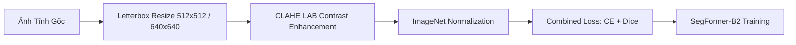

# Báo Cáo Thống Kê Bộ Dữ Liệu Ảnh Tĩnh (Fire_Smoke.v4i) & Kế Hoạch Huấn Luyện SegFormer (Spatial Core)

> **Dự án**: Nghiên cứu Khoa học - Hệ thống Phát hiện Sớm Lửa & Khói qua Video Giám Sát  
> **Giai đoạn**: Stage 1 - Huấn luyện Phần lõi Không gian (Spatial Core) với SegFormer  
> **Tập dữ liệu**: `data/Fire_Smoke.v4i.png-mask-semantic/`  
> **Ngày cập nhật**: 01/10/2026  

---

## MỤC LỤC
1. [Tổng Quan Bộ Ảnh Tĩnh Mới (v4i)](#1-tổng-quan-bộ-ảnh-tĩnh-mới-v4i)
2. [Thống Kê Chi Tiết Phân Bổ Nhãn Đối Tượng](#2-thống-kê-chi-tiết-phân-bổ-nhãn-đối-tượng)
3. [Thống Kê Đặc Tính Hình Học & Che Phủ Pixel (Pixel Coverage)](#3-thống-kê-đặc-tính-hình-học--che-phủ-pixel-pixel-coverage)
4. [Phân Tích Độ Phân Giải & Định Dạng Khung Hình](#4-phân-tích-độ-phân-giải--định-dạng-khung-hình)
5. [Đối Chiếu Sự Gia Tăng Dữ Liệu Giữa v3i và v4i](#5-đối-chiếu-sự-gia-tăng-dữ-liệu-giữa-v3i-và-v4i)
6. [Đề Xuất Pipeline Tiền Xử Lý Dữ Liệu Cho SegFormer](#6-đề-xuất-pipeline-tiền-xử-lý-dữ-liệu-cho-segformer)
7. [Chiến Lược Tăng Cường Dữ Liệu Chuyên Biệt (Data Augmentation)](#7-chiến-lược-tăng-cường-dữ-liệu-chuyên-biệt-data-augmentation)
8. [Phương Án Phân Chia 3 Tập Train / Val / Test (Stratified Split)](#8-phương-án-phân-chia-3-tập-train--val--test-stratified-split)
9. [Kết Nối Với Mô Hình Chuỗi Thời Gian TimeSformer (Stage 2)](#9-kết-nối-với-mô-hình-chuỗi-thời-gian-timesformer-stage-2)

---

## 1. TỔNG QUAN BỘ ẢNH TĨNH MỚI (v4i)

Bộ dữ liệu ảnh tĩnh `Fire_Smoke.v4i.png-mask-semantic` vừa được xuất từ Roboflow nhằm phục vụ cho **Giai đoạn 1 (Stage 1: Spatial Core)** — huấn luyện mô hình phân vùng ngữ nghĩa **SegFormer-B2** học các đặc trưng không gian (màu sắc, cấu trúc vân khói, đốm sáng ngọn lửa) trước khi chuyển giao trọng số sang TimeSformer.

| Chỉ số tổng quan | Giá trị thực tế | Ý nghĩa nghiên cứu |
|---|:---:|---|
| **Tổng số ảnh** | **1,058 ảnh** | Đã được chuẩn hóa cặp ảnh gốc và mask tương ứng |
| **Tổng số Semantic Mask** | **1,058 masks** | Định dạng PNG Grayscale (giá trị pixel đại diện cho class ID) |
| **Các lớp nhãn (Classes)** | **3 lớp** | `0`: Background, `1`: Fire (Lửa), `2`: Smoke (Khói) |
| **Nguồn dữ liệu** | Roboflow Export | Ảnh tĩnh chụp thực tế đa bối cảnh, góc nhìn rộng, độ phân giải cao |
| **Mục đích sử dụng** | **Pre-train Spatial** | Huấn luyện SegFormer để tạo Backbone không gian vững chắc |

---

## 2. THỐNG KÊ CHI TIẾT PHÂN BỔ NHÃN ĐỐI TƯỢNG

Toàn bộ 1,058 ảnh được phân loại theo 4 nhóm xuất hiện của ngọn lửa và làn khói:

| Nhóm trạng thái (Category) | Số lượng Ảnh | Tỷ lệ (%) | Ý nghĩa trong bài toán nhận diện |
|---|:---:|:---:|---|
| 🔥 **`fire_only`** | **550** | **52.0%** | Ngọn lửa trần bùng phát rõ ràng, không kèm khói lớn |
| 💨 **`smoke_only`** | **326** | **30.8%** | Giai đoạn cháy âm ỉ hoặc khói đặc bao trùm không thấy lửa |
| 🔥💨 **`both`** | **181** | **17.1%** | Đám cháy hoàn chỉnh xuất hiện đồng thời cả lửa và khói |
| ⬛ **`empty`** *(Background)* | **1** | **0.1%** | Ảnh nền âm tính thử nghiệm |
| **Tổng cộng** | **1,058** | **100.0%** | **100% đều có mask phân vùng chuẩn** |

- **Tổng số ảnh chứa Lửa**: **731 ảnh** (69.1%)
- **Tổng số ảnh chứa Khói**: **507 ảnh** (47.9%)
- **Ảnh chứa cả Lửa và Khói**: **181 ảnh** (17.1%)

---

## 3. THỐNG KÊ ĐẶC TÍNH HÌNH HỌC & CHE PHỦ PIXEL (PIXEL COVERAGE)

Thống kê diện tích pixel thực tế trên từng ảnh thể hiện rõ sự khác biệt hình thái giữa Lửa và Khói:

| Đại lượng đo lường | Vùng Lửa (Fire) | Vùng Khói (Smoke) | Nhận xét chuyên môn NCKH |
|---|:---:|:---:|---|
| **Diện tích trung bình (Mean)** | **12,465.3 px** | **56,704.9 px** | Khói có diện tích trung bình gấp **4.55 lần** ngọn lửa |
| **Tỷ lệ diện tích TB (% Image)** | **1.74%** | **11.24%** | Khói chiếm trung bình hơn 11% diện tích khung hình |
| **Tỷ lệ Trung vị (Median)** | **0.71%** | **6.76%** | **Lửa là mục tiêu siêu nhỏ**: Hơn 50% số ảnh có đốm lửa chiếm **dưới 0.71% diện tích khung hình**! |
| **Diện tích nhỏ nhất (Min)** | **7 px** *(0.0039%)* | **48 px** *(0.0208%)* | Đốm lửa mồi cực nhỏ ở cự ly xa |
| **Diện tích lớn nhất (Max)** | **235,984 px** *(25.6%)* | **414,778 px** *(62.4%)* | Đám cháy lớn bao trùm tầm nhìn camera |

> [!IMPORTANT]
> **Kết luận kiến trúc**: Với **Trung vị diện tích Lửa chỉ 0.71%**, mô hình SegFormer phải được cấu hình hàm mất mát kết hợp (**Combined Loss: Weighted Cross-Entropy + Dice Loss**) để không bị tín hiệu nền lấn át, đồng thời cần duy trì các tầng phân giải cao ở stage đầu của Mix Transformer (MiT-B2) để phát hiện đốm lửa mồi.

---

## 4. PHÂN TÍCH ĐỘ PHÂN GIẢI & ĐỊNH DẠNG KHUNG HÌNH

Ảnh trong tập `v4i` có độ phân giải phong phú từ HD đến Full HD, phản ánh chân thực môi trường camera quan sát:

| Độ phân giải | Số lượng Ảnh | Tỷ lệ (%) | Bối cảnh tương ứng |
|---|:---:|:---:|---|
| **1280 × 720** *(HD 720p)* | **417** | **39.4%** | Camera an ninh gia đình, nhà xưởng tầm trung |
| **640 × 640** *(Vuông chuẩn)* | **196** | **18.5%** | Ảnh trích xuất đã được crop chuẩn hóa |
| **416 × 416** | **82** | **7.8%** | Ảnh crop tập trung vào vùng nghi ngờ |
| **1920 × 1080** *(Full HD)* | **80** | **7.6%** | Camera giao thông, CCTV công nghiệp góc rộng |
| **960 × 540** *(qHD)* | **60** | **5.7%** | Luồng RTSP nén băng thông thấp |
| Các kích thước khác | **223** | **21.0%** | Ảnh đa tỷ lệ khác |

---

## 5. ĐỐI CHIẾU SỰ GIA TĂNG DỮ LIỆU GIỮA V3I VÀ V4I

| Tiêu chí | Bản v3i (Cũ) | Bản v4i (Mới tải về) | Tăng trưởng |
|---|:---:|:---:|:---:|
| **Tổng số ảnh** | 935 ảnh | **1,058 ảnh** | **+123 ảnh (+13.2%)** |
| **Tổng số mask** | 935 masks | **1,058 masks** | **+123 masks (+13.2%)** |
| **Số ảnh bổ sung mới** | — | **123 ảnh hoàn toàn mới** | Bổ sung thêm nhiều ca khó (khói mờ, góc xa) |
| **Độ bao phủ đa dạng** | 935 mẫu | 1,058 mẫu | Giúp mô hình SegFormer tổng quát hóa tốt hơn |

---

## 6. ĐỀ XUẤT PIPELINE TIỀN XỬ LÝ DỮ LIỆU CHO SEGFORMER

Mô hình SegFormer-B2 (NVIDIA MiT-B2 Backbone + All-MLP Decoder) đòi hỏi quy trình tiền xử lý ảnh tĩnh chuẩn hóa:



### 6.1. Chuẩn hóa kích thước bằng Letterbox Padding
- **Kích thước đầu vào chuẩn**: $512 \times 512$ (hoặc $640 \times 640$).
- **Phương pháp**: Giữ nguyên tỷ lệ khung hình gốc (Aspect Ratio), resize cạnh dài nhất về kích thước mục tiêu và thêm viền xám `(114, 114, 114)` vào hai cạnh còn lại.
- *Lý do*: Tuyệt đối không dùng `Direct Resize` vì sẽ làm méo hình thái ngọn lửa và vệt khói.

### 6.2. Tăng cường tương phản cục bộ CLAHE trên kênh L (LAB)
- Chuyển ảnh sang không gian màu **LAB**.
- Áp dụng CLAHE trên kênh độ sáng $L$ (`clipLimit=2.0`, `tileGridSize=(8, 8)`).
- Giữ nguyên kênh màu $A, B$ để không làm biến dạng phổ màu đỏ/cam đặc trưng của lửa.
- *Tác dụng*: Giúp SegFormer nhận diện rõ rệt các viền khói mỏng phân tán trên nền sáng hoặc nền tường xám.

### 6.3. Xử lý mất cân bằng diện tích (Loss Function Design)
Áp dụng hàm mất mát kết hợp đa nhiệm:
$$\mathcal{L}_{\text{total}} = \lambda_{\text{CE}} \mathcal{L}_{\text{WCE}} + \lambda_{\text{Dice}} \mathcal{L}_{\text{Dice}}$$
- **Weighted Cross-Entropy ($\mathcal{L}_{\text{WCE}}$)**: Đặt trọng số phạt cao hơn cho lớp Fire (do diện tích chỉ chiếm trung vị 0.71%) và Smoke so với Background.
- **Dice Loss ($\mathcal{L}_{\text{Dice}}$)**: Tối ưu trực tiếp chỉ số trùng khớp vùng giao (Intersection over Union), giúp mô hình không bị thiên lệch về việc dự đoán toàn bộ là nền.

---

## 7. CHIẾN LƯỢC TĂNG CƯỜNG DỮ LIỆU CHUYÊN BIỆT (DATA AUGMENTATION)

Áp dụng các kỹ thuật tăng cường dữ liệu mạnh mẽ cho ảnh tĩnh trước khi nạp vào SegFormer:

1. **Random Horizontal Flip ($p = 0.5$)**: Đảo chiều ngang khung hình và mask đồng thời.
2. **Random Rescale & Crop**: Tỷ lệ scale ngẫu nhiên từ $0.5 \times$ đến $2.0 \times$, sau đó crop ngẫu nhiên kích thước chuẩn để mô phỏng camera đặt ở các cự ly xa gần khác nhau.
3. **Photometric Distortion (Biến dạng màu sắc & ánh sáng)**:
   - Thay đổi ngẫu nhiên Brightness ($\pm 20\%$) và Contrast ($\pm 20\%$).
   - Thay đổi nhẹ Hue ($\pm 5^\circ$) để mô phỏng các camera có cân bằng trắng khác nhau.
4. **Gaussian Noise & Blur nhẹ ($p = 0.2$)**: Mô phỏng nhiễu hạt cảm biến ban đêm và sương mù.
5. ❌ **Cấm lật dọc (No Vertical Flip)**: Đảm bảo ngọn lửa và khói luôn hướng lên trên theo nguyên lý nhiệt động học.

---

## 8. PHƯƠNG ÁN PHÂN CHIA 3 TẬP TRAIN / VAL / TEST (STRATIFIED SPLIT)

### 8.1. Tỷ lệ phân chia tối ưu: 70% / 15% / 15%
Dữ liệu ảnh tĩnh được phân tầng ngẫu nhiên có kiểm soát (**Stratified Splitting**) dựa trên 4 nhóm nhãn (`fire_only`, `smoke_only`, `both`, `empty`) để đảm bảo tỷ lệ các lớp trong 3 tập là hoàn toàn tương đương:

| Tập dữ liệu | Số lượng Ảnh | Tỷ lệ (%) | Mục đích sử dụng trong Stage 1 |
|---|:---:|:---:|---|
| **TRAIN** | **742 ảnh** | **70.1%** | Huấn luyện trọng số Backbone MiT-B2 và All-MLP Decoder |
| **VAL** | **158 ảnh** | **14.9%** | Tinh chỉnh Learning Rate, đánh giá mIoU và Early Stopping |
| **TEST** | **158 ảnh** | **14.9%** | Đánh giá độc lập mIoU, Dice Score trên tập ảnh chưa từng thấy |
| **Tổng cộng** | **1,058 ảnh** | **100.0%** | |

### 8.2. Kiểm chứng độ cân bằng nhãn tuyệt đối giữa các tập

```text
Phân bổ Category trên 3 tập sau khi Stratify:
┌──────────┬──────────────┬──────────────┬──────────────┬──────────────┐
│  Tập     │  fire_only   │  smoke_only  │     both     │    empty     │
├──────────┼──────────────┼──────────────┼──────────────┼──────────────┤
│  TRAIN   │  386 (52.0%) │  228 (30.7%) │  127 (17.1%) │    1 (0.1%)  │
│  VAL     │   82 (51.9%) │   49 (31.0%) │   27 (17.1%) │    0 (0.0%)  │
│  TEST    │   82 (51.9%) │   49 (31.0%) │   27 (17.1%) │    0 (0.0%)  │
└──────────┴──────────────┴──────────────┴──────────────┴──────────────┘
```

*Nhận xét*: Tỷ lệ của các lớp `fire_only` (~52%), `smoke_only` (~31%), và `both` (~17%) ở cả 3 tập là **đồng nhất tuyệt đối**, đảm bảo kết quả đánh giá là hoàn toàn khách quan.

---

## 9. KẾT NỐI VỚI MÔ HÌNH CHUỖI THỜI GIAN TIMESFORMER (STAGE 2)

Sau khi huấn luyện thành công SegFormer trên tập `v4i`:

1. **Xuất trọng số không gian (Spatial Weights)**:
   - Lưu trữ checkpoint tốt nhất tại: `models/segformer_mit_b2_spatial_best.pth`.
2. **Chuyển giao sang TimeSformer (Stage 2)**:
   - Nhúng trực tiếp các tầng Mix-Transformer của SegFormer vào phần **Spatial Attention** của TimeSformer.
   - Giữ nguyên các đặc trưng không gian đã học, chỉ huấn luyện nhánh **Temporal Attention** và **Decoder Head** trên bộ dữ liệu **68 video chuỗi thời gian** (`data/dataset_video_prepared/`).
3. **Hiệu quả tổng thể**:
   - Tận dụng triệt để **1,058 ảnh tĩnh v4i** để có mắt nhìn không gian sắc bén.
   - Tận dụng **68 video (1,153 frame chuỗi thời gian)** để có bộ não phân tích chuyển động và chống báo động giả.

---

## 10. DANH MỤC CÁC FILE ĐÃ TẠO SẴN TRONG HỆ THỐNG

- **Báo cáo này**: [docs/Static_Dataset_v4i_Statistics_and_Preprocessing_Plan.md](file:///e:/NCKH/Code/Fire_Smoke_Early-Detection/docs/Static_Dataset_v4i_Statistics_and_Preprocessing_Plan.md)
- **Thư mục dữ liệu gốc**: [data/Fire_Smoke.v4i.png-mask-semantic/](file:///e:/NCKH/Code/Fire_Smoke_Early-Detection/data/Fire_Smoke.v4i.png-mask-semantic)
- **Manifest đầy đủ có cột split**: [data/data_splits/static_v4i_manifest_with_splits.csv](file:///e:/NCKH/Code/Fire_Smoke_Early-Detection/data/data_splits/static_v4i_manifest_with_splits.csv)
- **3 File Manifest phân chia nạp trực tiếp vào PyTorch**:
  - Tập Train (742 ảnh): [data/data_splits/static_v4i_train_manifest.csv](file:///e:/NCKH/Code/Fire_Smoke_Early-Detection/data/data_splits/static_v4i_train_manifest.csv)
  - Tập Val (158 ảnh): [data/data_splits/static_v4i_val_manifest.csv](file:///e:/NCKH/Code/Fire_Smoke_Early-Detection/data/data_splits/static_v4i_val_manifest.csv)
  - Tập Test (158 ảnh): [data/data_splits/static_v4i_test_manifest.csv](file:///e:/NCKH/Code/Fire_Smoke_Early-Detection/data/data_splits/static_v4i_test_manifest.csv)
