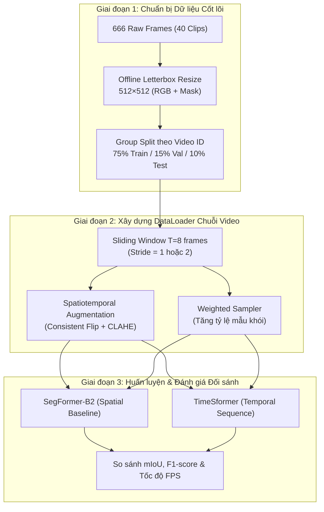

# Báo Cáo Phân Tích Thực Trạng Dữ Liệu & Đề Xuất Các Phương Pháp Tiền Xử Lý Cho Mô Hình Video (NCKH)

> **Dự án:** Fire & Smoke Early Detection & Tracking (NCKH)  
> **Tập dữ liệu chuẩn hóa:** `dataset_video_prepared/` (40 video clips, 666 frames)  
> **Mô hình mục tiêu:** SegFormer-B2 (Spatial Segmentation) & TimeSformer (Temporal Video Segmentation & Detection)  
> **Ngày lập:** 2026-09-09  

---

## MỤC LỤC
1. [PHẦN 1: PHÂN TÍCH THỰC TRẠNG & CÁC VẤN ĐỀ CỦA DỮ LIỆU](#phần-1-phân-tích-thực-trạng--các-vấn-đề-của-dữ-liệu)
2. [PHẦN 2: CÁC PHƯƠNG ÁN TIỀN XỬ LÝ ĐỀ XUẤT (KÈM ƯU / NHƯỢC ĐIỂM)](#phần-2-các-phương-án-tiền-xử-lý-đề-xuất-kèm-ưu--nhược-điểm)
   - [Nhóm 1: Chuẩn hóa Kích thước & Không gian (Spatial Rescaling)](#nhóm-1-chuẩn-hóa-kích-thước--không-gian-spatial-rescaling)
   - [Nhóm 2: Lấy mẫu & Đóng gói Chuỗi Thời Gian (Temporal Sampling)](#nhóm-2-lấy-mẫu--đóng-gói-chuỗi-thời-gian-temporal-sampling)
   - [Nhóm 3: Tăng Cường Dữ Liệu Đồng Bộ Thời Gian (Spatiotemporal Augmentation)](#nhóm-3-tăng-cường-dữ-liệu-đồng-bộ-thời-gian-spatiotemporal-augmentation)
   - [Nhóm 4: Cân Bằng Phân Bố Lớp & Vùng Khói/Lửa Nhỏ (Class Rebalancing)](#nhóm-4-cân-bằng-phân-bố-lớp--vùng-khóilửa-nhỏ-class-rebalancing)
   - [Nhóm 5: Chiến Lược Lưu Trữ & Tối Ưu Tốc Độ Nạp Dữ Liệu (Data Pipeline & Caching)](#nhóm-5-chiến-lược-lưu-trữ--tối-ưu-tốc-độ-nạp-dữ-liệu-data-pipeline--caching)
3. [PHẦN 3: MA TRẬN SO SÁNH & KHUYẾN NGHỊ LỘ TRÌNH THỰC NGHIỆM](#phần-3-ma-trận-so-sánh--khuyến-nghị-lộ-trình-thực-nghiệm)

---

## PHẦN 1: PHÂN TÍCH THỰC TRẠNG & CÁC VẤN ĐỀ CỦA DỮ LIỆU

Sau khi rà soát và đóng gói 40 video clips tại `dataset_video_prepared/` (gồm 666 frames và 666 mask tương ứng), chúng tôi phát hiện 6 thách thức kỹ thuật lớn cần giải quyết trước khi đưa vào huấn luyện mô hình:

### 1.1 Biến thiên độ phân giải & Tỷ lệ khung hình (Aspect Ratio Discrepancy)
* **Thực trạng:** 
  * Các video clip thu thập từ nhiều nguồn camera khác nhau: độ phân giải từ 4K ($3840\times 2160$), 1080p ($1920\times 1080$), 720p đến các video quay dọc dạng điện thoại ($1080\times 1920$, tỷ lệ $9:16$).
* **Hậu quả nếu resize trực tiếp (Direct Resize):** 
  * Nếu dùng `cv2.resize(img, (512, 512))` thô, hình dáng khí động học của làn khói (smoke plume) bốc lên theo phương thẳng đứng sẽ bị ép bè sang hai bên; ngọn lửa bị kéo dãn bất thường.
  * Mô hình Transformer học sai đặc trưng hình học thực tế, làm giảm khả năng khái quát hóa khi áp dụng vào camera giám sát thực địa.

### 1.2 Độ dài chuỗi video không đồng đều (Clip Length Disparity)
* **Thực trạng:**
  * Video ngắn nhất chỉ có **5 đến 6 frames** (ví dụ: `12935692_1080_1920_60fps_pure`, `14477514_1080_1920_30fps_pure`).
  * Video dài nhất có **49 đến 50 frames** (ví dụ: `00e18d86-3389d8dc_pure`, `0d48a1ea_pexels_heavy_smoke_8339804_pure`).
* **Hậu quả:**
  * Mô hình TimeSformer yêu cầu đầu vào tensor cố định dạng $[B, T, C, H, W]$ (thường $T=8$ hoặc $T=16$). 
  * Không thể nạp trực tiếp toàn bộ video vào một batch nếu không có chiến lược cắt chuỗi hoặc lặp khung hình có kiểm soát.

### 1.3 Mất cân bằng phân bố lớp nghiêm trọng (Severe Class Imbalance)
* **Thống kê trên 666 frames chuẩn hóa:**
  * `fire_only` (chỉ có lửa): **420 frames (63.1%)** $\rightarrow$ Chiếm đa số áp đảo.
  * `both` (có cả lửa và khói): **158 frames (23.7%)**.
  * `smoke_only` (chỉ có khói): **80 frames (12.0%)** $\rightarrow$ Thiểu số.
  * `empty` (nền sạch/không có sự cố): **8 frames (1.2%)** $\rightarrow$ Cực kỳ ít.
* **Hậu quả:**
  * Mô hình có xu hướng thiên kiến (bias) nhận diện lửa tốt hơn khói.
  * Khói sớm (*early smoke*) là mục tiêu quan trọng nhất của đề tài NCKH nhằm cảnh báo trước khi bùng cháy lớn, nhưng lại bị thiếu hụt mẫu huấn luyện.
  * Thiếu frame âm tính (`empty`) dễ dẫn đến tỷ lệ **False Positive** cao khi gặp hơi nước, bụi, ánh đèn.

### 1.4 Khói giai đoạn đầu có diện tích nhỏ & biên mờ nhạt (Fuzzy Boundary & Low Contrast)
* **Thực trạng:**
  * Ở các frame khởi phát, khói chỉ chiếm $< 1.5 - 3\%$ tổng diện tích frame.
  * Trong điều kiện ánh sáng yếu hoặc nền xám (tường bê tông, bầu trời nhiều mây), giá trị pixel RGB của khói hòa lẫn vào nền background.
* **Hậu quả:**
  * Khi qua phép Patch Embedding ($16\times 16$) của TimeSformer hoặc downsampling của SegFormer, tín hiệu khói mỏng dễ bị suy giảm triệt tiêu (feature vanishing).

### 1.5 Nguy cơ rò rỉ dữ liệu thời gian (Temporal Data Leakage)
* **Thực trạng:**
  * Các frame liên tiếp trong cùng một video clip có độ tương đồng quang học rất cao ($> 95\%$ similarity).
* **Hậu quả:**
  * Nếu dùng phương pháp chia ngẫu nhiên (Random Shuffle Split) ở cấp độ frame, các frame $t$ và $t+1$ của cùng một clip sẽ chia đều vào cả tập Train và Test.
  * Điểm đánh giá (mIoU / Accuracy) sẽ **cao giả tạo (overfitting)**, làm mất tính khoa học và không phản ánh đúng năng lực của mô hình khi gặp video mới lạ ngoài thực tế.

### 1.6 Nghẽn cổ chai I/O khi huấn luyện (I/O & Compute Bottleneck)
* **Thực trạng:**
  * Nạp liên tục ảnh 4K/2K từ đĩa cục bộ hoặc qua Modal Network Volume rồi mới resize trên GPU sẽ làm quá tải băng thông I/O, khiến GPU liên tục phải chờ CPU tiền xử lý.

---

## PHẦN 2: CÁC PHƯƠNG ÁN TIỀN XỬ LÝ ĐỀ XUẤT (KÈM ƯU / NHƯỢC ĐIỂM)

---

### NHÓM 1: CHUẨN HÓA KÍCH THƯỚC & KHÔNG GIAN (SPATIAL RESCALING)

#### Phương án 1.1: Letterbox Resize with Constant Padding (Khuyên dùng cho Baseline)
* **Cách thực hiện:** Giữ nguyên tỷ lệ khung hình ban đầu. Tính tỷ lệ scale theo cạnh lớn nhất để đưa về $512$ (hoặc $224$), sau đó chèn viền đen (pixel value = 0) hoặc viền xám vào hai cạnh ngắn để đạt kích thước vuông $512\times 512$. Cả ảnh RGB và Mask đều áp dụng cùng ma trận transform.
* **Ưu điểm:**
  * Bảo toàn 100% tỷ lệ hình học và hướng lan truyền tự nhiên của ngọn lửa/cột khói.
  * Mask và ảnh khớp chính xác từng pixel, không sinh lỗi méo viền.
* **Nhược điểm:**
  * Xuất hiện viền đen dư thừa (chiếm khoảng 20-35% diện tích tính toán với video $16:9$ hoặc $9:16$).

#### Phương án 1.2: Random / Saliency-guided Center Cropping
* **Cách thực hiện:** Thay vì thu nhỏ toàn bộ ảnh và đệm viền đen, thuật toán xác định trọng tâm của vùng khói/lửa trên mask rồi thực hiện crop ngẫu nhiên một vùng $512\times 512$ bao quanh đối tượng.
* **Ưu điểm:**
  * Tận dụng tối đa 100% diện tích pixel đầu vào cho mô hình học, loại bỏ viền đen vô nghĩa.
  * Giúp mô hình quan sát cận cảnh các chi tiết vi mô của tia lửa nhỏ và khói loãng.
* **Nhược điểm:**
  * Làm mất đi bối cảnh không gian toàn cảnh (Scene Context) xung quanh; khó áp dụng đồng bộ khi đối tượng di chuyển nhanh qua các frame.

#### Phương án 1.3: Multi-Scale Input Pyramids (Đa tỉ lệ)
* **Cách thực hiện:** Huấn luyện mô hình ở nhiều độ phân giải khác nhau ($384\times 384, 512\times 512, 640\times 640$) theo từng epoch.
* **Ưu điểm:** Giúp mô hình bền vững với khoảng cách camera xa - gần.
* **Nhược điểm:** Tăng thời gian huấn luyện và phức tạp hóa việc batching trên GPU.

---

### NHÓM 2: LẤY MẪU & ĐÓNG GÓI CHUỖI THỜI GIAN (TEMPORAL SAMPLING)

Mô hình TimeSformer nhận đầu vào là chuỗi $T=8$ khung hình.

#### Phương án 2.1: Sliding Window với Bước nhảy Cố định (Fixed Stride Sliding Window)
* **Cách thực hiện:**
  * Với video dài $\ge 8$ frames: trượt một cửa sổ độ dài $T=8$ với bước nhảy $s \in \{1, 2\}$. Mỗi cửa sổ là 1 sample độc lập.
  * Với video ngắn $< 8$ frames: áp dụng **Edge Repeat** (lặp lại frame cuối) hoặc **Symmetric Reflection** (lật đối xứng chuỗi) để đủ $T=8$.
* **Ưu điểm:**
  * Đơn giản, giữ trọn vẹn đặc tính chuyển động theo trình tự thời gian tự nhiên.
  * Tăng số lượng mẫu huấn luyện đáng kể từ các clip dài (tăng từ 40 video lên hàng trăm mẫu chuỗi $T=8$).
* **Nhược điểm:**
  * Các cửa sổ kề nhau có độ chồng lấn cao (high overlap).

#### Phương án 2.2: Uniform Temporal Subsampling (Lấy mẫu cách đều)
* **Cách thực hiện:** Bất kể video dài hay ngắn, chia tổng số frame của clip thành $T=8$ khoảng bằng nhau và lấy 1 frame tại mỗi khoảng:
  $$\text{index}_i = \left\lfloor i \times \frac{N - 1}{T - 1} \right\rfloor, \quad i = 0, 1, \dots, T-1$$
* **Ưu điểm:**
  * Bao quát được toàn bộ diễn biến từ lúc bắt đầu xuất hiện khói đến khi cháy lớn trong toàn bộ video clip.
* **Nhược điểm:**
  * Với clip 50 frame, bước nhảy thời gian giữa 2 frame liên tiếp trở nên quá lớn, ngọn lửa thay đổi đột ngột làm mất tính liên tục vi mô mà TimeSformer cần học.

#### Phương án 2.3: Hybrid Dynamic Sampling (Lấy mẫu Động kết hợp)
* **Cách thực hiện:** 
  * Trong lúc Train: Lấy mẫu ngẫu nhiên cửa sổ 8 frame liên tiếp tại vị trí bất kỳ trong video (Random Clip Slicing).
  * Trong lúc Eval/Test: Trượt cửa sổ tuần tự không overlap để suy luận toàn bộ video.
* **Ưu điểm:** Mô hình không bị học vẹt vị trí cố định của từng clip.

---

### NHÓM 3: TĂNG CƯỜNG DỮ LIỆU ĐỒNG BỘ THỜI GIAN (SPATIOTEMPORAL AUGMENTATION)

> [!CAUTION]
> Trong xử lý video, tất cả các phép biến đổi không gian **bắt buộc phải dùng chung một bộ tham số ngẫu nhiên (Fixed Random Seed)** cho toàn bộ $T=8$ frame trong cùng một sample.

#### Phương án 3.1: Consistent Geometric Augmentation
* **Kỹ thuật:** 
  * *Random Horizontal Flip* ($p=0.5$): Lật cả chuỗi theo phương ngang (không áp dụng vertical flip vì lửa và khói luôn bốc lên trên theo quy luật đối lưu nhiệt).
  * *Consistent Random Affine / Rotation* ($\pm 10^\circ$): Giả lập camera lắp đặt bị nghiêng.
* **Hiệu quả:** Tăng gấp đôi tính đa dạng về hướng lan truyền của khói.

#### Phương án 3.2: CCTV & Atmospheric Condition Augmentation (Mô phỏng Môi trường Camera)
* **Kỹ thuật:**
  * **CLAHE (Contrast Limited Adaptive Histogram Equalization):** Áp dụng CLAHE trên kênh $L$ trong không gian màu LAB.
    * *Mục đích:* Tăng cường độ tương phản cục bộ, làm lộ rõ các vân khói mỏng/khói sớm bị chìm vào nền tường hoặc sương mù.
  * **Random Motion Blur & Gaussian Noise:**
    * *Mục đích:* Giả lập hiện tượng camera giám sát rung lắc do gió mạnh hoặc nhiễu hạt ban đêm.
  * **Random Brightness & Gamma Jitter:**
    * *Mục đích:* Mô phỏng ánh sáng chập chờn, bóng mây che phủ hoặc ban ngày / chiều tối.

#### Phương án 3.3: Temporal Jittering & Frame Dropping
* **Kỹ thuật:** Ngẫu nhiên bỏ qua 1 frame trong chuỗi (ví dụ nạp $t_1, t_2, t_4, t_5\dots$ thay vì $t_1, t_2, t_3, t_4$) với xác suất $p=0.2$.
* **Mục đích:** Giúp TimeSformer bền vững khi hệ thống truyền dẫn camera bị mất gói tin (packet drop) hoặc camera bị sụt giảm FPS.

---

### NHÓM 4: CÂN BẰNG PHÂN BỐ LỚP & VÙNG KHÓI/LỬA NHỎ (CLASS REBALANCING)

#### Phương án 4.1: Weighted Random Sampler (Lấy mẫu có trọng số ở DataLoader)
* **Cách thực hiện:** Tính toán trọng số cho mỗi clip dựa trên sự xuất hiện của lớp thiểu số:
  $$W_{\text{clip}} = \frac{1}{\text{Tần suất lớp trong dataset}}$$
  Các clip chứa `smoke_only` và `empty` sẽ được bộ lấy mẫu chọn với tần suất gấp $2.5 - 3.0$ lần so với các clip chỉ có `fire_only`.
* **Ưu điểm:** Khắc phục triệt để tình trạng lệch mẫu 63.1% Fire mà không làm tăng dung lượng đĩa cứng.

#### Phương án 4.2: Loss Function Điều Chỉnh Trọng Số (Compound Focal-Dice Loss)
* **Cách thực hiện:** Thay thế hoàn toàn CrossEntropy thông thường bằng hàm mất mát hỗn hợp:
  $$\mathcal{L}_{\text{total}} = \mathcal{L}_{\text{Focal}} + \alpha \mathcal{L}_{\text{Dice}}$$
  * $\mathcal{L}_{\text{Focal}}$: Tập trung phạt nặng các pixel khó phân biệt (biên khói mỏng).
  * $\mathcal{L}_{\text{Dice}}$: Đo lường trực tiếp độ chồng lấn IoU, triệt tiêu sự chênh lệch diện tích giữa vùng cháy nhỏ và vùng background rộng lớn.
  * Gán trọng số phạt lớp: $w_{\text{bg}} = 0.2, w_{\text{fire}} = 1.0, w_{\text{smoke}} = 2.2$.

#### Phương án 4.3: Copy-Paste Augmentation cho Khói Nhỏ (Nâng cao)
* **Cách thực hiện:** Cắt các mảng khói mỏng từ các clip `smoke_only` và dán ngẫu nhiên (kèm alpha blending) vào các vị trí khác nhau trên các frame nền sạch (`empty`).
* **Ưu điểm:** Tăng sinh dữ liệu khói sớm một cách chủ động.
* **Nhược điểm:** Phức tạp khi ghép chuỗi video để giữ tính mượt mà qua các frame.

---

### NHÓM 5: CHIẾN LƯỢC LƯU TRỮ & TỐI ƯU TỐC ĐỘ NẠP DỮ LIỆU (DATA PIPELINE & CACHING)

#### Phương án 5.1: Pure Online Processing (Đọc ảnh gốc & Resize lúc train)
* **Quy trình:** DataLoader đọc trực tiếp ảnh gốc (kích thước 1080p/4K), thực hiện letterbox resize và augment ngay trong hàm `__getitem__`.
* **Đánh giá:** 
  * ❌ *Nhược điểm:* CPU và Disk I/O bị quá tải nghiêm trọng, GPU H100/A10G sẽ bị nghẽn (GPU Utilization $< 30\%$).

#### Phương án 5.2: Two-Stage Hybrid Pipeline (Khuyên dùng)
* **Quy trình:**
  * **Stage 1 (Offline Preprocessing):** Resize trước toàn bộ 666 ảnh và mask về kích thước chuẩn $512\times 512$ (hoặc $224\times 224$) bằng thuật toán Letterbox, lưu thành bộ dataset nén chuẩn PNG hoặc định dạng Tensor (`.pt` / `.npy`).
  * **Stage 2 (Online Augmentation):** Trong quá trình train, DataLoader chỉ việc đọc nhanh các ảnh $512\times 512$ đã resize, sau đó áp dụng ngẫu nhiên các phép Augmentation (Flip, ColorJitter, CLAHE) trên RAM.
* **Đánh giá:**
  * ✅ *Ưu điểm:* Tốc độ nạp dữ liệu tăng gấp $5 - 10$ lần, tận dụng tối đa 100% công suất GPU, tiết kiệm chi phí thuê GPU trên Modal.

---

## PHẦN 3: MA TRẬN SO SÁNH & KHUYẾN NGHỊ LỘ TRÌNH THỰC NGHIỆM

### 3.1 Bảng So Sánh Tổng Hợp Các Phương Án

| Nhóm kỹ thuật | Phương án | Mức độ phức tạp | Tác động cải thiện độ chính xác | Khuyến nghị áp dụng |
| :--- | :--- | :---: | :---: | :---: |
| **Spatial Rescaling** | 1.1 Letterbox Padding | Thấp | Cao (Tránh méo hình đối tượng) | ⭐ **Bắt buộc (Standard)** |
| | 1.2 Center Saliency Crop | Trung bình | Trung bình (Tập trung vùng nhỏ) | Tùy chọn nâng cao |
| **Temporal Sampling** | 2.1 Fixed Stride Sliding Window | Thấp | Cao (Tạo chuỗi $T=8$ mượt) | ⭐ **Bắt buộc cho TimeSformer** |
| | 2.2 Uniform Subsampling | Thấp | Thấp (Mất chuyển động vi mô) | Không khuyến nghị |
| **Augmentation** | 3.1 Consistent Geometric (Flip) | Thấp | Cao (Bảo toàn physics thời gian) | ⭐ **Bắt buộc** |
| | 3.2 CCTV CLAHE + Motion Blur | Trung bình | Rất cao (Tăng cường khói sớm) | ⭐ **Rất nên dùng cho NCKH** |
| | 3.3 Frame Dropping | Trung bình | Trung bình (Bền vững camera lag) | Tùy chọn giai đoạn 2 |
| **Class Balancing** | 4.1 Weighted Random Sampler | Thấp | Cao (Bù đắp thiếu hụt khói) | ⭐ **Khuyên dùng** |
| | 4.2 Compound Focal + Dice Loss | Thấp | Rất cao (Xử lý vùng khói nhỏ) | ⭐ **Khuyên dùng** |
| **Pipeline Storage** | 5.2 Two-Stage Hybrid (Offline $512\times 512$) | Thấp | Rất cao (Tối ưu I/O & chi phí GPU) | ⭐ **Bắt buộc khi chạy Modal** |

---

### 3.2 Lộ Trình Thực Nghiệm Khuyến Nghị (3 Giai Đoạn)

1. **Giai đoạn 1 (Ngay lập tức):** Chạy script offline đưa toàn bộ 40 video clips về định dạng Letterbox $512\times 512$ và chia Group Split Train/Val/Test theo Video ID để có baseline sạch.
2. **Giai đoạn 2 (Tích hợp DataLoader):** Cấu hình bộ DataLoader hỗ trợ cửa sổ trượt $T=8$ frames kèm phép tăng cường CLAHE và đồng bộ Flip.
3. **Giai đoạn 3 (Huấn luyện & Đánh giá):** Chạy thử nghiệm trên SegFormer-B2 và TimeSformer với Compound Focal-Dice Loss, so sánh độ nhạy đối với khói sớm.
