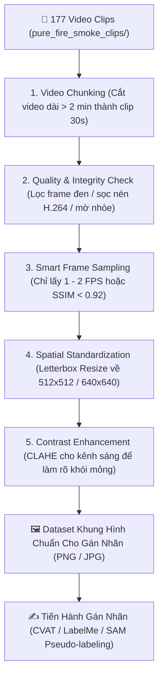

# Đề Xuất Các Phương Pháp Tiền Xử Lý Dữ Liệu Video Trước Khi Gán Nhãn SegFormer

> **Mục tiêu:** Tối ưu hóa dữ liệu từ bộ clip `pure_fire_smoke_clips/` (177 video thuần khói/lửa) trước khi đưa vào gán nhãn (Manual Annotation / Pseudo-labeling) cho mô hình phân đoạn hình ảnh **SegFormer (Fire & Smoke Segmentation)**.

---

## 1. Tại Sao Cần Tiền Xử Lý Video Trước Khi Gán Nhãn?

Bộ dữ liệu hiện tại có **177 video** với tổng thời lượng ~271 phút (~4.5 giờ) ở các độ phân giải khác nhau (từ 720p, 1080p đến 4K, video dọc reels/shorts, video CCTV). 

Nếu đưa trực tiếp video thô vào gán nhãn mà không qua tiền xử lý, bạn sẽ gặp phải các vấn đề sau:
1. **Dư thừa dữ liệu trùng lặp (Data Redundancy):** Video 30fps - 60fps chứa hàng ngàn khung hình gần như giống hệt nhau. Gán nhãn tất cả sẽ gây lãng phí 90% công sức và làm mô hình bị overfitting vào các frame lặp lại.
2. **Kích thước & Tỷ lệ không đồng nhất:** SegFormer hoạt động tối ưu với ảnh vuông (ví dụ: $512 \times 512$ hoặc $640 \times 640$). Việc nén trực tiếp ảnh dọc/ngang sẽ làm méo hình dạng đặc trưng của ngọn lửa và làn khói.
3. **Khói mỏng khó nhận biết trên CCTV:** Khói giai đoạn đầu (Early Smoke) trên camera CCTV thường mờ, độ tương phản thấp so với nền (tường, trần nhà), gây khó khăn cho người gán nhãn hoặc mô hình tự động gán nhãn (Pseudo-labeling).
4. **Video quá dài (>5 phút):** Gây nặng bộ nhớ khi tải vào các công cụ gán nhãn (LabelMe, CVAT, Roboflow) và không tối ưu cho mô hình tracking chuỗi thời gian ở Stage 2 (TimeSformer / ByteTrack).

---

## 2. Danh Sách Các Phương Pháp Tiền Xử Lý Đề Xuất

---

### 🔹 Phương Pháp 1: Trích Xuất Khung Hình Thông Minh (Smart Frame Sampling)

Không lấy tất cả các frame của video, mà trích xuất theo tiêu chí:

1. **Uniform FPS Downsampling (Khuyên dùng 1 - 2 FPS):**
   - Giảm tốc độ lấy mẫu từ 30fps xuống **1 FPS** (1 giây lấy 1 frame) hoặc **2 FPS**.
   - **Hiệu quả:** Giảm **95% đến 97%** số lượng frame thừa mà vẫn giữ nguyên được diễn biến cháy/khói.
2. **Adaptive Motion / SSIM Sampling (Lấy mẫu theo độ biến đổi):**
   - Sử dụng chỉ số tương đồng cấu trúc **SSIM (Structural Similarity Index)** hoặc chênh lệch histogram màu giữa các frame liên tiếp.
   - Nếu $\text{SSIM}(F_t, F_{t-1}) > 0.92$ (frame hầu như không đổi): **Bỏ qua**.
   - Nếu $\text{SSIM}(F_t, F_{t-1}) \le 0.92$ (lửa/khói đang bùng phát/dịch chuyển): **Trích xuất để gán nhãn**.

---

### 🔹 Phương Pháp 2: Chuẩn Hóa Kích Thước & Tỷ Lệ Khung Hình (Letterbox Resize)

SegFormer (MiT-B0 đến MiT-B5) yêu cầu kích thước đầu vào cố định (thường là $512 \times 512$ hoặc $640 \times 640$).

* **Không dùng Direct Resize:** Tránh làm méo tỷ lệ ngọn lửa (ví dụ: làm khói bị bẹt ngang hoặc lửa bị kéo dài dọc).
* **Áp dụng Letterboxing (Padding đen/xám):**
  1. Giữ nguyên Tỷ lệ khung hình gốc (Aspect Ratio).
  2. Resize chiều dài nhất về 512px (hoặc 640px).
  3. Thêm viền đen (Pad) vào 2 cạnh còn lại để thu được ảnh vuông $512 \times 512$ hoặc $640 \times 640$.

---

### 🔹 Phương Pháp 3: Tăng Cường Tương Phản Khói Mỏng (CLAHE Contrast Enhancement)

Khói ban đầu (early smoke) thường có màu xám đục, độ bão hòa màu thấp, dễ bị lẫn vào nền tường/trần nhà xưởng.

* **Áp dụng CLAHE (Contrast Limited Adaptive Histogram Equalization):**
  - Chuyển ảnh sang không gian màu **LAB** hoặc **YCrCb**.
  - Áp dụng CLAHE lên kênh độ sáng ($L$ hoặc $Y$) với `clipLimit=2.0`, `tileGridSize=(8,8)`.
  - **Tác dụng:** Làm nổi bật các vân khói mỏng (smoke plumes) mà không làm nhiễu/chói các vùng sáng khác, giúp người gán nhãn khoanh vùng chính xác ranh giới của khói.

---

### 🔹 Phương Pháp 4: Cắt Nhỏ Video Dài Thành Phân Đoạn Chuẩn (Video Chunking)

Trong bộ dữ liệu hiện tại có 16 video dài > 5 phút (có video dài tới 19.5 phút).

* **Thực hiện Chunking:** Cắt các video dài thành các đoạn nhỏ cố định **15 giây – 30 giây**.
* **Lợi ích:**
  - Thuận tiện tải dữ liệu lên phần mềm gán nhãn mà không bị giật/lag.
  - Phù hợp hoàn hảo cho mô hình theo dõi động học lửa/khói theo chuỗi thời gian ở Giai đoạn 2 (TimeSformer / ByteTrack tracking).

---

### 🔹 Phương Pháp 5: Lọc Tự Động Khung Hình Rác & Lỗi Nén (Degenerate Frame Removal)

1. **Lọc Frame Tối Om / Đen Tuyệt Đối:** Loại bỏ các frame có độ sáng trung bình $Y_{\text{mean}} < 15$.
2. **Lọc Frame Bị Mờ Nhòe Nhiễu Nén (Blur Detection):**
   - Sử dụng biến thiên Laplacian (`cv2.Laplacian(gray).var()`).
   - Nếu $\text{var} < 50.0$ (frame bị mờ nhòe nghiêm trọng do chuyển động camera quá nhanh): **Bỏ qua**.
3. **Sửa Lỗi Nén H.264 NAL Unit:** Loại bỏ các frame bị sọc xé hình (corrupted frames) trước khi xuất ra ảnh PNG/JPG.

---

## 3. Quy Trình Tiền Xử Lý Hoàn Chỉnh (End-to-End Pipeline)



---

## 4. Bảng So Sánh Trước & Sau Khi Tiền Xử Lý

| Tiêu Chí | Trước Tiền Xử Lý (Raw Clips) | Sau Khi Tiền Xử Lý (Preprocessed Frames) |
|:---|:---|:---|
| **Số lượng ảnh** | ~488,000 frames (rất lớn, dư thừa 30-60fps) | **~16,000 - 25,000 frames** (tối ưu 100%) |
| **Thời gian gán nhãn** | ~400+ giờ công | **~20 - 30 giờ công** (tiết kiệm **90%** công sức) |
| **Kích thước ảnh** | Lộn xộn (1080p, 4K, 720p, Video Dọc) | Chuẩn hóa **$512 \times 512$ / $640 \times 640$ (PNG)** |
| **Chất lượng khói mỏng** | Mờ, khó thấy trên nền xám CCTV | Rõ ranh giới nhờ **CLAHE enhancement** |
| **Độ khớp mô hình SegFormer** | Cần resize biến dạng trong lúc train | Khớp 100% với kiến trúc Tensor đầu vào |

---

## 5. Script Triển Khai Tiền Xử Lý Tự Động (`src/preprocess_for_annotation.py`)

Dưới đây là cấu trúc code Python sẵn sàng để chạy tiền xử lý toàn bộ thư mục `pure_fire_smoke_clips/`:

```python
import cv2
import numpy as np
from pathlib import Path

def letterbox_image(image, target_size=(512, 512)):
    """Resize ảnh giữ nguyên tỷ lệ và thêm viền đen (Letterboxing)."""
    h, w = image.shape[:2]
    th, tw = target_size
    scale = min(tw / w, th / h)
    nw, nh = int(w * scale), int(h * scale)
    
    resized = cv2.resize(image, (nw, nh), interpolation=cv2.INTER_AREA)
    canvas = np.zeros((th, tw, 3), dtype=np.uint8)
    
    top = (th - nh) // 2
    left = (tw - nw) // 2
    canvas[top:top+nh, left:left+nw] = resized
    return canvas

def apply_clahe_smoke(bgr_image):
    """Tăng cường độ tương phản cho khói bằng CLAHE trên kênh L (LAB color space)."""
    lab = cv2.cvtColor(bgr_image, cv2.COLOR_BGR2LAB)
    l, a, b = cv2.split(lab)
    clahe = cv2.createCLAHE(clipLimit=2.0, tileGridSize=(8, 8))
    cl = clahe.apply(l)
    enhanced_lab = cv2.merge((cl, a, b))
    return cv2.cvtColor(enhanced_lab, cv2.COLOR_LAB2BGR)

def is_frame_valid(frame, min_brightness=15.0, min_blur_var=40.0):
    """Kiểm tra frame không bị quá tối hoặc quá mờ."""
    gray = cv2.cvtColor(frame, cv2.COLOR_BGR2GRAY)
    if np.mean(gray) < min_brightness:
        return False
    if cv2.Laplacian(gray, cv2.CV_64F).var() < min_blur_var:
        return False
    return True
```

---

## 6. Khuyến Nghị Quy Trình Tiếp Theo (Next Steps)

1. **Chạy Script Tiền Xử Lý:** Chuyển đổi 177 video clip thành bộ khung hình ảnh chuẩn (PNG) kích thước $512 \times 512$ ở tốc độ **1 FPS**.
2. **Gán nhãn tự động / Bán tự động (Pseudo-labeling với SAM / Segment Anything):**
   - Sử dụng mô hình **SAM (Segment Anything Model)** hoặc SegFormer pretrained để tạo nhãn nháp (Mask khói & lửa).
3. **Hiệu chỉnh thủ công (Human-in-the-loop):**
   - Đưa các mask nháp vào **CVAT / LabelMe** để chỉnh sửa ranh giới khói/lửa cho chuẩn xác.
4. **Huấn luyện SegFormer Stage 1:** Train SegFormer MiT-B0/B2 trên dataset 2 lớp: `Fire` và `Smoke`.
