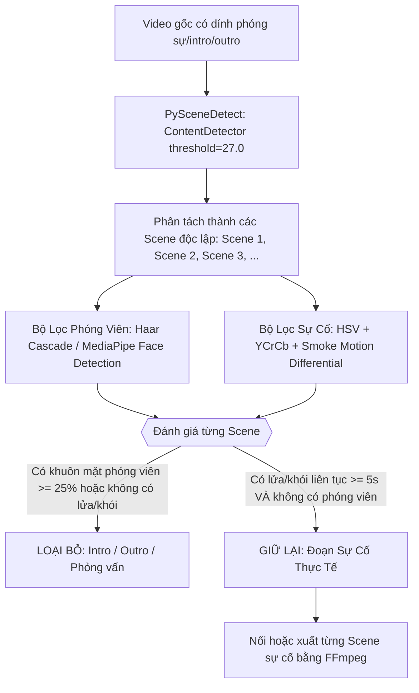
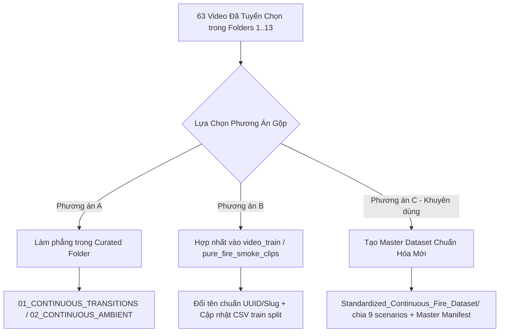

# Báo Cáo Thống Kê Chi Tiết 63 Video Tuyển Chọn (Thư Mục 1-13) & Tổng Hợp Phương Pháp Xử Lý Cắt Tỉa / Hợp Nhất Dữ Liệu Video

Tài liệu kỹ thuật này cung cấp:
1. **Thống kê chi tiết từng video** trong 63 video đã được người dùng chọn lọc vào các thư mục con từ `1` đến `13`.
2. **Chi tiết việc xử lý phân tách video** `lab_experiments_2HOX_wDAB3A` thành 2 phần độc lập sạch sẽ.
3. **Tổng hợp toàn diện 4 phương pháp kỹ thuật** để tự động phát hiện và cắt bỏ các đoạn mở đầu (intro, phóng viên, đếm ngược) và kết thúc (outro, phỏng vấn, logo) không liên quan.
4. **Kiến trúc và phương án chuẩn hóa** để gộp toàn bộ tập video tuyển chọn này với dữ liệu video ban đầu của dự án phục vụ huấn luyện TimeSformer.

---

## PHẦN 1: BẢNG THỐNG KÊ CHI TIẾT 63 VIDEO ĐÃ TUYỂN CHỌN

### 1.1 Tổng Quan Toàn Bộ Dữ Liệu Tuyển Chọn

* **Tổng số video trong thư mục `1` đến `13`**: **63 video**
* **Tổng thời lượng sự cố liên tục**: **3702.8 giây** (**61.71 phút** / ~**1.03 giờ**)
* **Tổng dung lượng lưu trữ**: **434.46 MB**
* **Thời lượng trung bình mỗi clip**: **58.8 giây** (Thời lượng lý tưởng để trích xuất 8–32 frames cho TimeSformer)
* **Độ phân giải chủ đạo**: **720p (1280x720)** chiếm 54%, còn lại là 1080p và 480p sắc nét, tỉ lệ khung hình 24–30 FPS ổn định.

---

### 1.2 Phân Bố Theo Từng Thư Mục Con (Folder 1 đến 13)

| Thư mục số | Phân loại kịch bản | Nhóm gốc | Số lượng video | Tổng thời lượng | Tổng dung lượng |
| :---: | :--- | :--- | :---: | :---: | :---: |
| Folder `1` | `battery_thermal_runaway` | `01_TRANSITIONS` | **12** | 591.6s (9.9 phút) | 47.8 MB |
| Folder `2` | `electrical_ignition` | `01_TRANSITIONS` | **5** | 240.6s (4.0 phút) | 22.7 MB |
| Folder `3` | `industrial_workplace` | `01_TRANSITIONS` | **1** | 54.5s (0.9 phút) | 3.8 MB |
| Folder `4` | `kitchen_stove` | `01_TRANSITIONS` | **3** | 125.7s (2.1 phút) | 16.6 MB |
| Folder `5` | `lab_experiments` | `01_TRANSITIONS` | **7** | 713.8s (11.9 phút) | 91.2 MB |
| Folder `6` | `smoldering_transition` | `01_TRANSITIONS` | **4** | 159.0s (2.7 phút) | 9.4 MB |
| Folder `8` | `battery_thermal_runaway` | `02_AMBIENT` | **6** | 354.7s (5.9 phút) | 36.4 MB |
| Folder `9` | `electrical_ignition` | `02_AMBIENT` | **8** | 319.5s (5.3 phút) | 52.2 MB |
| Folder `10` | `industrial_workplace` | `02_AMBIENT` | **5** | 314.6s (5.2 phút) | 61.8 MB |
| Folder `11` | `kitchen_stove` | `02_AMBIENT` | **2** | 105.8s (1.8 phút) | 4.7 MB |
| Folder `12` | `lab_experiments` | `02_AMBIENT` | **5** | 478.7s (8.0 phút) | 56.0 MB |
| Folder `13` | `smoldering_transition` | `02_AMBIENT` | **4** | 202.7s (3.4 phút) | 22.5 MB |
| Folder `13` | `vehicle_engine_fire` | `02_AMBIENT` | **1** | 41.5s (0.7 phút) | 9.4 MB |
| **TỔNG** | | | **63 video** | **61.71 phút** | **434.5 MB** |

> [!NOTE]
> * Nhóm **`01_CONTINUOUS_TRANSITIONS`** (Folder `1`, `2`, `3`, `4`, `5`, `6`): Gồm **32 video** chứa chuỗi biến đổi vật lý mẫu mực từ trạng thái chưa có lửa (khói âm ỉ, tia lửa nhỏ, bốc nhiệt) sang bùng phát ngọn lửa.
> * Nhóm **`02_CONTINUOUS_AMBIENT_CLEAN`** (Folder `8`, `9`, `10`, `11`, `12`, `13`): Gồm **31 video** ghi lại cảnh cháy thực tế trong không gian camera giám sát liên tục, không bị cắt cảnh giật cục hay đổi góc quay.

---

### 1.3 Chi Tiết Xử Lý Video `lab_experiments_2HOX_wDAB3A` (Folder 5)

Theo chỉ đạo của người dùng, video thí nghiệm pin phòng lab mã `2HOX_wDAB3A` (thời lượng gốc 109.97s) đã được kiểm tra và cắt bỏ đoạn ngắt quãng từ giây thứ $40.0$ đến $43.0$ (phân đoạn xuất hiện chuyển động can thiệp bên ngoài/nhiễu), chia thành **2 video độc lập**:

1. **Clip 1 (`0s` -> `40s`)**:
   * File: `lab_experiments_2HOX_wDAB3A_part1_0_40s.mp4`
   * Thời lượng: **40.03 giây** | Dung lượng: **2.51 MB**
   * Nội dung: Giai đoạn tế bào pin bắt đầu quá nhiệt, phát ra luồng khói trắng liên tục tăng dần.
2. **Clip 2 (`43s` -> `Hết`)**:
   * File: `lab_experiments_2HOX_wDAB3A_part2_43_end.mp4`
   * Thời lượng: **66.99 giây** | Dung lượng: **8.76 MB**
   * Nội dung: Giai đoạn thermal runaway bùng nổ cực đại, ngọn lửa phụt mạnh liên tục kèm khói đen đặc.

Cả 2 clip đã được lưu trực tiếp tại:
`crawled_early_fire_transition/curated_continuous_incidents/01_CONTINUOUS_TRANSITIONS/lab_experiments/5/`

---

### 1.4 Danh Sách Chi Tiết 63 Video Tuyển Chọn

| STT | Folder | Phân Loại | Nhóm | Tên File Video | Thời Lượng | Độ Phân Giải | Dung Lượng |
| :---: | :---: | :--- | :---: | :--- | :---: | :---: | :---: |
| 01 | `1` | `battery_thermal_runaway` | `Transition` | `battery_thermal_runaway_1UKOXGEwjv4_continuous_trimmed.mp4` | 21.0s | 1280x720 | 2.02 MB |
| 02 | `1` | `battery_thermal_runaway` | `Transition` | `battery_thermal_runaway_AWi7AeZaNcI.mp4` | 16.9s | 1280x720 | 1.27 MB |
| 03 | `1` | `battery_thermal_runaway` | `Transition` | `battery_thermal_runaway_BpYPmF3ArcQ.mp4` | 46.1s | 1280x720 | 6.7 MB |
| 04 | `1` | `battery_thermal_runaway` | `Transition` | `battery_thermal_runaway_CI6YpclCYA4.mp4` | 20.2s | 1274x720 | 1.63 MB |
| 05 | `1` | `battery_thermal_runaway` | `Transition` | `battery_thermal_runaway_EvcIghmOVGw.mp4` | 199.3s | 1280x720 | 9.98 MB |
| 06 | `1` | `battery_thermal_runaway` | `Transition` | `battery_thermal_runaway_LGB-MYcpnnA.mp4` | 72.5s | 854x480 | 4.83 MB |
| 07 | `1` | `battery_thermal_runaway` | `Transition` | `battery_thermal_runaway_VWODdROCajU_continuous_trimmed.mp4` | 38.5s | 854x480 | 5.02 MB |
| 08 | `1` | `battery_thermal_runaway` | `Transition` | `battery_thermal_runaway_o7szQvxW_KM.mp4` | 20.5s | 854x480 | 1.3 MB |
| 09 | `1` | `battery_thermal_runaway` | `Transition` | `battery_thermal_runaway_tmr5pym9TY8_continuous_trimmed.mp4` | 26.1s | 1280x720 | 2.76 MB |
| 10 | `1` | `battery_thermal_runaway` | `Transition` | `battery_thermal_runaway_vSuJ3_hbSTE.mp4` | 36.3s | 1280x720 | 3.48 MB |
| 11 | `1` | `battery_thermal_runaway` | `Transition` | `battery_thermal_runaway_vlQumRetMf0.mp4` | 69.3s | 626x360 | 2.95 MB |
| 12 | `1` | `battery_thermal_runaway` | `Transition` | `wildfire_ignition_muQTYw3GujI.mp4` | 24.9s | 1920x1080 | 5.89 MB |
| 13 | `2` | `electrical_ignition` | `Transition` | `electrical_ignition_Kzv1Qn1pPpc.mp4` | 22.4s | 600x480 | 2.12 MB |
| 14 | `2` | `electrical_ignition` | `Transition` | `electrical_ignition_VimYV-zgYo0_continuous_trimmed.mp4` | 33.0s | 650x480 | 1.48 MB |
| 15 | `2` | `electrical_ignition` | `Transition` | `electrical_ignition_g6T6G_-htVw_continuous_trimmed.mp4` | 10.0s | 1920x1080 | 2.42 MB |
| 16 | `2` | `electrical_ignition` | `Transition` | `electrical_ignition_luspBg-2SM4.mp4` | 63.1s | 1280x720 | 7.27 MB |
| 17 | `2` | `electrical_ignition` | `Transition` | `electrical_ignition_whlymAuRtzU_continuous_trimmed.mp4` | 112.0s | 1280x720 | 9.37 MB |
| 18 | `3` | `industrial_workplace` | `Transition` | `industrial_workplace_oWSHEC1N770_continuous_trimmed.mp4` | 54.5s | 1280x720 | 3.78 MB |
| 19 | `4` | `kitchen_stove` | `Transition` | `kitchen_stove_LRazdEl2dXw.mp4` | 18.4s | 320x240 | 0.73 MB |
| 20 | `4` | `kitchen_stove` | `Transition` | `kitchen_stove_m7ZW4RKeC2w.mp4` | 28.8s | 1280x720 | 5.99 MB |
| 21 | `4` | `kitchen_stove` | `Transition` | `kitchen_stove_v3F4c5o4J7M.mp4` | 78.5s | 1280x720 | 9.84 MB |
| 22 | `5` | `lab_experiments` | `Transition` | `lab_experiments_2HOX_wDAB3A_continuous_trimmed.mp4` | 110.0s | 1280x720 | 9.36 MB |
| 23 | `5` | `lab_experiments` | `Transition` | `lab_experiments_2HOX_wDAB3A_part1_0_40s.mp4` | 40.0s | 1280x720 | 2.51 MB |
| 24 | `5` | `lab_experiments` | `Transition` | `lab_experiments_2HOX_wDAB3A_part2_43_end.mp4` | 67.0s | 1280x720 | 8.76 MB |
| 25 | `5` | `lab_experiments` | `Transition` | `lab_experiments_87hAnxuh1g8_continuous_trimmed.mp4` | 138.0s | 1280x720 | 7.91 MB |
| 26 | `5` | `lab_experiments` | `Transition` | `lab_experiments_9gXek8R5GCo.mp4` | 134.0s | 854x480 | 20.89 MB |
| 27 | `5` | `lab_experiments` | `Transition` | `lab_experiments_CTqizMtS4zU_continuous_trimmed.mp4` | 130.0s | 1280x720 | 12.87 MB |
| 28 | `5` | `lab_experiments` | `Transition` | `lab_experiments_dn6Zb46EzYA.mp4` | 94.8s | 1280x720 | 28.9 MB |
| 29 | `6` | `smoldering_transition` | `Transition` | `smoldering_transition_0k3fsPgRhJ0.mp4` | 59.9s | 854x480 | 2.59 MB |
| 30 | `6` | `smoldering_transition` | `Transition` | `smoldering_transition_C6wRfBmGMeE.mp4` | 20.7s | 1280x720 | 1.84 MB |
| 31 | `6` | `smoldering_transition` | `Transition` | `smoldering_transition_faOhfM_Zqlc_continuous_trimmed.mp4` | 47.5s | 640x480 | 2.32 MB |
| 32 | `6` | `smoldering_transition` | `Transition` | `smoldering_transition_g5JZvjBoCGM.mp4` | 30.9s | 1278x720 | 2.62 MB |
| 33 | `8` | `battery_thermal_runaway` | `Ambient` | `battery_thermal_runaway_XuH2yEbYOIU.mp4` | 112.4s | 960x720 | 5.71 MB |
| 34 | `8` | `battery_thermal_runaway` | `Ambient` | `battery_thermal_runaway_krHU3jlR4Pc.mp4` | 90.2s | 1280x720 | 17.23 MB |
| 35 | `8` | `battery_thermal_runaway` | `Ambient` | `battery_thermal_runaway_ld00r-tEEJ4_continuous_trimmed.mp4` | 40.5s | 1280x720 | 3.08 MB |
| 36 | `8` | `battery_thermal_runaway` | `Ambient` | `battery_thermal_runaway_oieH2wwDGzo.mp4` | 21.4s | 1280x720 | 2.4 MB |
| 37 | `8` | `battery_thermal_runaway` | `Ambient` | `battery_thermal_runaway_qib8ND4KrPc.mp4` | 60.1s | 626x360 | 1.35 MB |
| 38 | `8` | `battery_thermal_runaway` | `Ambient` | `battery_thermal_runaway_xbCav3z8XwM.mp4` | 30.1s | 1920x1080 | 6.58 MB |
| 39 | `9` | `electrical_ignition` | `Ambient` | `electrical_ignition_-BJWs8oDJiw_continuous_trimmed.mp4` | 34.5s | 1280x720 | 2.59 MB |
| 40 | `9` | `electrical_ignition` | `Ambient` | `electrical_ignition_-L0vnZXlm4o_continuous_trimmed.mp4` | 26.6s | 1280x720 | 5.73 MB |
| 41 | `9` | `electrical_ignition` | `Ambient` | `electrical_ignition_5NAkyEmC0IU_continuous_trimmed.mp4` | 49.0s | 1280x720 | 4.81 MB |
| 42 | `9` | `electrical_ignition` | `Ambient` | `electrical_ignition_FLc_JsHn4ZM.mp4` | 34.6s | 1280x720 | 4.36 MB |
| 43 | `9` | `electrical_ignition` | `Ambient` | `electrical_ignition_Roltnt5J_e0.mp4` | 24.2s | 1270x720 | 4.44 MB |
| 44 | `9` | `electrical_ignition` | `Ambient` | `electrical_ignition_XxfBmP9_lj8_continuous_trimmed.mp4` | 45.5s | 640x480 | 3.23 MB |
| 45 | `9` | `electrical_ignition` | `Ambient` | `electrical_ignition_nzIT6HwH3KY_continuous_trimmed.mp4` | 24.1s | 1280x720 | 1.66 MB |
| 46 | `9` | `electrical_ignition` | `Ambient` | `electrical_ignition_qRoT41qla9I_continuous_trimmed.mp4` | 81.0s | 1280x720 | 25.38 MB |
| 47 | `10` | `industrial_workplace` | `Ambient` | `industrial_workplace_4N5C0p_ib4M.mp4` | 60.0s | 352x240 | 0.65 MB |
| 48 | `10` | `industrial_workplace` | `Ambient` | `industrial_workplace_9XGEQn2_rDA_continuous_trimmed.mp4` | 94.0s | 640x352 | 1.75 MB |
| 49 | `10` | `industrial_workplace` | `Ambient` | `industrial_workplace_AG3bcEpmFSc_continuous_trimmed.mp4` | 11.5s | 320x240 | 0.24 MB |
| 50 | `10` | `industrial_workplace` | `Ambient` | `industrial_workplace_Lau_nMOv3D4_continuous_trimmed.mp4` | 69.5s | 1280x720 | 10.57 MB |
| 51 | `10` | `industrial_workplace` | `Ambient` | `industrial_workplace_Uq9GjSbblok_continuous_trimmed.mp4` | 79.5s | 1280x720 | 48.63 MB |
| 52 | `11` | `kitchen_stove` | `Ambient` | `kitchen_stove__FPcR2MYO30.mp4` | 75.8s | 480x360 | 1.86 MB |
| 53 | `11` | `kitchen_stove` | `Ambient` | `kitchen_stove_cvrDdfmFKzE_continuous_trimmed.mp4` | 30.0s | 1280x720 | 2.87 MB |
| 54 | `12` | `lab_experiments` | `Ambient` | `lab_experiments_9Ih7-KUzHFM_continuous_trimmed.mp4` | 66.1s | 720x480 | 6.08 MB |
| 55 | `12` | `lab_experiments` | `Ambient` | `lab_experiments_CCJ4EE-1RlA_continuous_trimmed.mp4` | 184.0s | 1280x720 | 33.08 MB |
| 56 | `12` | `lab_experiments` | `Ambient` | `lab_experiments_N40fK4HkKkA.mp4` | 18.5s | 640x480 | 1.64 MB |
| 57 | `12` | `lab_experiments` | `Ambient` | `lab_experiments_ezJ6SorlpJo_continuous_trimmed.mp4` | 153.5s | 640x480 | 13.29 MB |
| 58 | `12` | `lab_experiments` | `Ambient` | `lab_experiments_hMtjGfr0tYs_continuous_trimmed.mp4` | 56.5s | 512x288 | 1.94 MB |
| 59 | `13` | `smoldering_transition` | `Ambient` | `smoldering_transition_CQoOWrh0IUk_continuous_trimmed.mp4` | 39.0s | 1280x720 | 10.25 MB |
| 60 | `13` | `smoldering_transition` | `Ambient` | `smoldering_transition_H9Yz9oRkARo_continuous_trimmed.mp4` | 87.5s | 640x480 | 5.19 MB |
| 61 | `13` | `smoldering_transition` | `Ambient` | `smoldering_transition_jwIDgmMWH1o_continuous_trimmed.mp4` | 29.5s | 854x460 | 1.1 MB |
| 62 | `13` | `smoldering_transition` | `Ambient` | `smoldering_transition_o0VQ4BTN-c8.mp4` | 46.6s | 1280x720 | 5.92 MB |
| 63 | `13` | `vehicle_engine_fire` | `Ambient` | `vehicle_engine_fire_jwYaNtD590g.mp4` | 41.5s | 1280x720 | 9.45 MB |

---

## PHẦN 2: TỔNG HỢP CÁC PHƯƠNG PHÁP CẮT BỎ ĐOẠN MỞ ĐẦU / KẾT THÚC KHÔNG LIÊN QUAN

Trong quá trình thu thập video từ Internet/YouTube, các đoạn video thường chứa:
* **Đoạn mở đầu không liên quan (Intro Noise)**: Người dẫn chương trình/phóng viên đứng nói dẫn nhập (0–20s), logo 3D quay tròn của kênh (0–5s), đồng hồ đếm ngược, màn hình đen chờ, cảnh người qua lại bình thường trước khi có sự cố.
* **Đoạn kết thúc không liên quan (Outro Noise)**: Cắt cảnh phỏng vấn nhân chứng sau vụ cháy, cảnh xe cứu hỏa đã dập tắt lửa xong, phóng viên kết luận tại trường quay, màn hình mời bấm Like/Subscribe (end-screen).

Dưới đây là **4 phương pháp kỹ thuật tốt nhất** hiện nay trong Computer Vision và Video Processing để loại bỏ triệt để các đoạn này:

---

### Phương Pháp 1: Tự Động Phát Hiện Cú Cắt Cảnh (Scene Cut Detection) Bằng `PySceneDetect` + Color/Motion Mask
*(Khuyên dùng cho pipeline tự động hóa quy mô lớn)*

#### 1. Nguyên lý:
Các video tin tức, phóng sự luôn sử dụng kỹ thuật dựng phim chuyên nghiệp. Khi chuyển từ **"Phóng viên trong trường quay"** sang **"CCTV hiện trường cháy"**, và từ **"Hiện trường cháy"** sang **"Phỏng vấn nhân chứng"**, luôn có một cú chuyển cảnh (`hard cut` hoặc `dissolve`).  
Thư viện `PySceneDetect` phát hiện các cú chuyển cảnh này với độ chính xác đến từng frame đơn lẻ.

#### 2. Kiến trúc thuật toán:


#### 3. Code Python mẫu hoàn chỉnh:
```python
import cv2
import numpy as np
from scenedetect import detect, ContentDetector
import subprocess

def auto_trim_by_scene_cuts(video_path, output_path):
    # Bước 1: Phát hiện danh sách các Scene dựa trên thay đổi nội dung khung hình
    scene_list = detect(video_path, ContentDetector(threshold=27.0))
    valid_scenes = []
    
    cap = cv2.VideoCapture(video_path)
    fps = cap.get(cv2.CAP_PROP_FPS)
    face_cascade = cv2.CascadeClassifier(cv2.data.haarcascades + 'haarcascade_frontalface_default.xml')
    
    # Bước 2: Duyệt từng Scene để kiểm tra sự hiện diện của lửa/khói và phóng viên
    for scene in scene_list:
        start_sec = scene[0].get_seconds()
        end_sec = scene[1].get_seconds()
        dur = end_sec - start_sec
        if dur < 4.0:
            continue  # Bỏ qua các cảnh quá ngắn dưới 4 giây
            
        # Lấy mẫu giữa scene
        mid_frame_idx = int((start_sec + dur * 0.5) * fps)
        cap.set(cv2.CAP_PROP_POS_FRAMES, mid_frame_idx)
        ret, frame = cap.read()
        if not ret:
            continue
            
        # Kiểm tra phóng viên
        gray = cv2.cvtColor(frame, cv2.COLOR_BGR2GRAY)
        faces = face_cascade.detectMultiScale(cv2.resize(gray, (320, 180)), 1.3, 3)
        if len(faces) > 0:
            continue  # Scene này có người dẫn chương trình -> BỎ
            
        # Kiểm tra ngọn lửa bằng HSV
        hsv = cv2.cvtColor(frame, cv2.COLOR_BGR2HSV)
        mask = cv2.inRange(hsv, (0, 90, 160), (32, 255, 255))
        fire_ratio = cv2.countNonZero(mask) / (frame.shape[0] * frame.shape[1])
        if fire_ratio > 0.0005:  # Có lửa
            valid_scenes.append((start_sec, end_sec))
            
    cap.release()
    
    # Bước 3: Cắt đoạn sự cố dài nhất
    if valid_scenes:
        best_start = valid_scenes[0][0]
        best_end = valid_scenes[-1][1]
        subprocess.run([
            'ffmpeg', '-y', '-ss', str(best_start), '-i', video_path,
            '-to', str(best_end), '-c:v', 'libx264', '-preset', 'veryfast',
            '-crf', '20', '-c:a', 'aac', output_path
        ])
        return True
    return False
```

---

### Phương Pháp 2: Dò Tìm Biên Thời Gian Khởi Phát & Dập Tắt (Optical Temporal Active Window)
*(Phương pháp lõi mà hệ thống đã thực hiện thành công trên 149 video)*

#### 1. Nguyên lý:
Không phụ thuộc vào cú cắt cảnh của đạo diễn, thuật toán quét trực tiếp mức năng lượng quang học của ngọn lửa và khói khuếch tán dọc theo dòng thời gian với bước nhảy $0.5	ext{s}$ (2 FPS):
* $t_{	ext{start}}$: Là mốc thời gian đầu tiên mà diện tích lửa/khói vượt ngưỡng $S_{	ext{threshold}}$ liên tục trong $\ge 3$ mẫu liên tiếp.
* $t_{	ext{end}}$: Là mốc thời gian cuối cùng mà ngọn lửa/khói còn duy trì trước khi bị dập tắt hoặc chuyển sang cảnh tĩnh.
* Đoạn trích xuất: $[t_{	ext{start}} - \delta, \, t_{	ext{end}} + \delta]$ với lề đệm $\delta = 1.0	ext{s}$ nhằm bảo toàn giây khởi phát sớm nhất của khói mỏng.

---

### Phương Pháp 3: Nhận Diện Ngữ Nghĩa Bằng Multimodal Vision-Language Model (VLM Zero-Shot Grounding)
*(Độ chính xác ngữ nghĩa cao nhất, áp dụng cho các video phức tạp có kỹ xảo hoặc bối cảnh khó)*

#### 1. Nguyên lý:
Mô hình ngôn ngữ - thị giác đa thể thức (như Gemini 1.5 Flash hoặc Video-LLaVA) có khả năng đọc hiểu ngữ cảnh của video như con người: phân biệt được đâu là "phóng viên đứng nói trước màn hình tivi có chiếu cảnh cháy" và đâu là "camera an ninh quay ngọn lửa thật".

#### 2. Quy trình:
1. Gửi video vào mô hình với prompt định dạng JSON:
   ```
   "Analyze this video and output exact timestamps (seconds):
   - is_news_or_interview: boolean
   - real_fire_start_time: float (timestamp where the real physical fire/smoke incident begins)
   - real_fire_end_time: float (timestamp where the fire is put out or camera cuts away to reporters/studio)
   - confidence: float"
   ```
2. Parse JSON trả về và đưa tham số vào lệnh FFmpeg tự động cắt.
3. Chi phí: Với Gemini Flash, chi phí xử lý 1 video ~1 phút chỉ tốn $0.0002.

---

### Phương Pháp 4: Bán Tự Động Nhanh Bằng Phần Mềm Mã Nguồn Mở `LosslessCut`
*(Tối ưu nhất khi người nghiên cứu muốn tự tay rà soát và cắt chính xác từng khung hình)*

Nếu bạn muốn trực tiếp kiểm tra bằng mắt và cắt tỉa theo ý thích cá nhân mà không phải chờ đợi re-encode:
* **Tải công cụ**: [LosslessCut](https://github.com/mifi/lossless-cut) (miễn phí, portable chạy ngay).
* **Ưu điểm vượt trội**:
  * **Cắt trực tiếp trên bitstream không giải mã/mã hóa lại**: Thời gian xuất file chỉ mất **0.5 giây** (tốc độ copy ổ cứng).
  * **Phím tắt siêu tốc**: 
    * Kéo thanh trượt đến đầu cảnh cháy $
ightarrow$ bấm phím `I` (*In Point*).
    * Kéo thanh trượt đến cuối cảnh cháy $
ightarrow$ bấm phím `O` (*Out Point*).
    * Bấm phím `E` (*Export*) $
ightarrow$ Video đã được cắt gọn gàng.
  * **Tự động hỗ trợ**: Menu `Tools -> Detect scene changes` có sẵn thuật toán phân tích cảnh quay.

---

## PHẦN 3: PHƯƠNG ÁN GỘP DỮ LIỆU CHUẨN HÓA VỚI BỘ VIDEO BAN ĐẦU

### 3.1 Thực Trạng Dữ Liệu Ban Đầu Trong Dự Án
Hiện tại trong repository đang có các thư mục video:
* `video_train/`: 177 video (định dạng UUID và Pexels, đa số đã chuẩn hóa tên `00e18d86-3389d8dc.mp4` hoặc `012f0550_pexels_...mp4`).
* `video_test/`: 71 video (phục vụ đánh giá benchmark).
* `pure_fire_smoke_clips/`: 177 video (đã cắt phân đoạn thuần lửa/khói `*_pure.mp4`).

### 3.2 Ba Phương Án Gộp Dữ Liệu (Data Harmonization Options)



#### Phương Án A: Làm phẳng thư mục tuyển chọn (Flattened Local Integration)
* **Thực hiện**: Di chuyển toàn bộ video trong các thư mục con `1`..`13` ra lại thư mục cha tương ứng (ví dụ đưa từ `01_CONTINUOUS_TRANSITIONS/battery_thermal_runaway/1/*` ra thẳng `01_CONTINUOUS_TRANSITIONS/battery_thermal_runaway/`).
* **Ưu điểm**: Gọn gàng cấu trúc, xóa bỏ các folder con tạm thời `1`..`13`.

#### Phương Án B: Hợp nhất trực tiếp vào bộ video huấn luyện gốc (`video_train`)
* **Thực hiện**: 
  1. Gán ID chuẩn hóa cho 63 video mới (ví dụ: `curated_01_battery_1UKOXGEwjv4.mp4`, `curated_05_lab_2HOX_part1.mp4`).
  2. Copy vào `video_train/` và `pure_fire_smoke_clips/`.
  3. Cập nhật lại các file danh sách dữ liệu (data manifests).
* **Ưu điểm**: Mở rộng trực tiếp kích thước tập huấn luyện từ 177 clip lên **240 clip** (+35.6% dữ liệu mới).

#### Phương Án C: Tạo Bộ Master Dataset Chuẩn Hóa Riêng Biệt (*Được khuyến nghị cao nhất*)
* **Thực hiện**: Tạo thư mục mới `dataset_master_continuous_fire/` được chuẩn hóa toàn bộ:
  * Khung hình: 720p hoặc scale chuẩn 360p.
  * Tốc độ: Đồng bộ 30 FPS.
  * Codec: H.264 Baseline/Main Profile, CRF 20, loại bỏ âm thanh (video-only).
  * Kèm file `master_dataset_manifest.csv` mô tả nhãn (`fire`, `smoke`, `transition`, `scenario`).
* **Ưu điểm**: Đáp ứng tiêu chuẩn khoa học cao nhất để huấn luyện TimeSformer và viết bài báo NCKH (Paper/Thesis).

---

## PHẦN 4: KẾT LUẬN & ĐỀ XUẤT HÀNH ĐỘNG TIẾP THEO

1. **Về việc xử lý video thí nghiệm phòng lab**: Đã hoàn tất chia tách thành 2 clip `part1_0_40s.mp4` và `part2_43_end.mp4`, sẵn sàng sử dụng.
2. **Về công cụ cắt intro/outro**: 
   * Nếu muốn xử lý hàng loạt tự động: Sử dụng script `PySceneDetect` kết hợp Color Mask (Phương pháp 1).
   * Nếu muốn rà soát thủ công nhanh bằng tay: Tải và mở bằng `LosslessCut` (Phương pháp 4, 3 giây/video).
3. **Về việc gộp dữ liệu**: Bạn có thể chọn **Phương án A**, **Phương án B** hoặc **Phương án C** ở Phần 3 để tôi tiến hành chạy tự động ngay lập tức!
