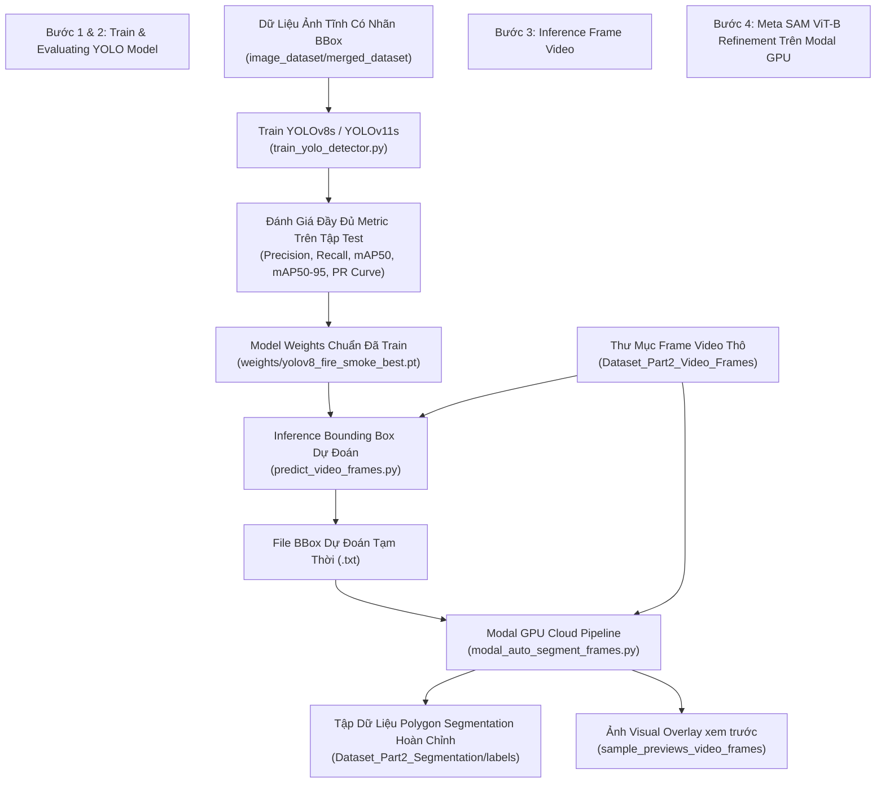

# Kế Hoạch Triển Khai: Train YOLO -> Đánh Giá Test Set -> Inference Frame -> SAM Segment (Modal GPU)

Quy trình tự động hóa hoàn chỉnh dựa trên dữ liệu tĩnh có sẵn nhãn Bounding Box.

---

## 📸 Kiến Trúc Quy Trình (Pipeline Workflow)

---

## 🛠️ Chi Tiết Các Bước Thực Hiện

### 1. Fix đường dẫn `data.yaml`
- Cập nhật [`image_dataset/merged_dataset/data.yaml`](file:///e:/NCKH/Code/Fire_Smoke_Early-Detection/image_dataset/merged_dataset/data.yaml) trỏ chuẩn xác đến thư mục `train/images`, `val/images`, `test/images` trên Windows.

### 2. Train mô hình YOLOv8 trên Dữ liệu Ảnh Tĩnh
- **Script**: [`src/train_yolo_detector.py`](file:///e:/NCKH/Code/Fire_Smoke_Early-Detection/src/train_yolo_detector.py)
- **Cấu hình**:
  - Model base: `yolov8s.pt` (hoặc `yolov11s.pt`)
  - Data: `image_dataset/merged_dataset/data.yaml`
  - Epochs: 30 - 50 epochs (dùng GPU local / PyTorch)
  - Classes: `0: fire`, `1: smoke`
- **Output**: Weight tốt nhất lưu tại `weights/yolov8_fire_smoke_best.pt`.

### 3. Đánh giá Mô hình YOLO trên Tập Test (Evaluation)
- **Script**: [`src/evaluate_yolo.py`](file:///e:/NCKH/Code/Fire_Smoke_Early-Detection/src/evaluate_yolo.py)
- **Đánh giá trên tập `test` (`split='test'`)**:
  - **Metrics**: Precision, Recall, mAP50, mAP50-95 cho từng lớp `fire` và `smoke`.
  - **Biểu đồ**: Xuất Confusion Matrix, PR Curve, F1-Confidence Curve.
  - **Báo cáo**: Lưu file báo cáo tổng hợp `reports/yolo_test_evaluation_report.md`.

### 4. Inference BBounding Box trên các Frame Video
- **Script**: [`src/predict_video_frames.py`](file:///e:/NCKH/Code/Fire_Smoke_Early-Detection/src/predict_video_frames.py)
- Quét các frame video trong `Dataset_Part2_Video_Frames`.
- Dự đoán Bounding Box nhãn Lửa & Khói với ngưỡng tin cậy `conf >= 0.3`.
- Ghi tạm thời tọa độ BBox thu được.

### 5. Meta SAM ViT-B Auto-Segmentation trên Modal GPU Cloud
- **Script**: [`modal_auto_segment_frames.py`](file:///e:/NCKH/Code/Fire_Smoke_Early-Detection/modal_auto_segment_frames.py)
- Đẩy BBounding Box dự đoán làm Prompt lên Modal GPU (NVIDIA T4/A10G).
- SAM ViT-B cắt ranh giới polygon chuẩn xác cho Lửa & Khói.
- Xuất file nhãn `.txt` chuẩn YOLO Segmentation và lưu ảnh preview visual overlay (`sample_previews_video_frames/`).

---

## 📋 Kiểm Thu & Xác Nhận (Verification Plan)

1. **Huấn luyện & Metric**: Xuất đầy đủ bảng chỉ số Precision, Recall, mAP50, mAP50-95 trên tập Test.
2. **Inference BBox**: Kiểm tra số lượng frame video được dự đoán Bounding Box.
3. **Modal SAM Output**: Kiểm tra 1,000+ file nhãn segment polygon và ảnh visual preview màu sắc (Lửa: Đỏ, Khói: Cyan).
